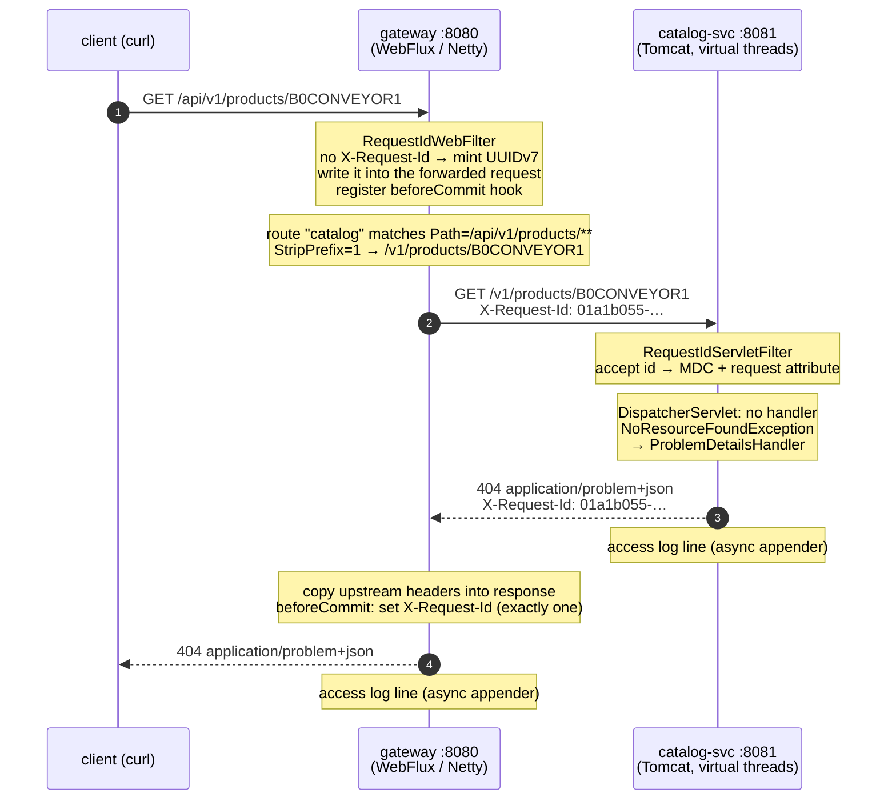

# 00 — A request through the edge

M0 has no business logic yet, but it already has the parts every later request depends on: the
gateway, the request id, the error contract, the access log, the metrics. This chapter sends one
request through them and looks at everything that comes back.

The request asks for a product that catalog-svc cannot serve yet (M1 adds the catalog), so the
answer is a 404. That is useful: it exercises routing, id propagation and the error path,
without any business code in the way.

```
GET /api/v1/products/B0CONVEYOR1
```

> Everything below — headers, bodies, log lines, timings — was produced by running the M0 build
> (Java 25, Spring Boot 4.1.2, Spring Cloud Gateway 5.0.4, Tomcat 11.0.27, Reactor Netty 1.3.8).
> Functional runs: MacBook Pro M3 Pro. Benchmarks: a Northeastern Explorer compute node (16 cores
> of an AMD EPYC 7702). Reproduction commands are at the end.

## The path



## 1. The exchange

```
$ curl -i localhost:8080/api/v1/products/B0CONVEYOR1

HTTP/1.1 404 Not Found
transfer-encoding: chunked
Content-Type: application/problem+json
Date: Fri, 06 Nov 2026 10:08:53 GMT
X-Request-Id: 01a1b055-28cc-788d-8e9f-db89bd9f3497

{"detail":"No resource at this path.","instance":"/v1/products/B0CONVEYOR1","status":404,
 "title":"Not Found","requestId":"01a1b055-28cc-788d-8e9f-db89bd9f3497",
 "timestamp":"2026-11-06T10:08:53.611339Z"}
```

The body was written by catalog-svc and passed through the gateway untouched. Two things to
notice:

- `instance` is `/v1/products/B0CONVEYOR1`, the path *catalog-svc* saw after `StripPrefix=1`,
  not the public `/api/v1/...` path. This is fine for correlation, but it does show the
  internal path to clients. M1 will decide whether the gateway rewrites `instance` or services
  stop setting it.
- `requestId` in the body equals the `X-Request-Id` header, so an error report from a client
  is enough to find every log line for that call.

## 2. One id, two processes

The id was minted at the gateway, forwarded, adopted by catalog-svc, and written into both
access logs:

```
02:08:53.626 INFO 53119 --- [catalog-svc] [omcat-handler-9] [01a1b055-28cc-788d-8e9f-db89bd9f3497] conveyor.access : GET /v1/products/B0CONVEYOR1 -> 404 in 31179 us
02:08:53.644 INFO 53118 --- [gateway]     [ctor-http-nio-3] [01a1b055-28cc-788d-8e9f-db89bd9f3497] conveyor.access : GET /api/v1/products/B0CONVEYOR1 -> 404 in 192376 us
```

This was the first request after boot, so it is slow: 192 ms at the gateway, 31 ms of that in
catalog-svc. The rest is one-time work — JIT, the gateway's first upstream connection, Netty's
DNS resolver setup. The very next request, with a caller-supplied id:

```
02:08:53.680 INFO 53119 --- [catalog-svc] [mcat-handler-10] [prime-day-demo-0001] conveyor.access : GET /v1/products/B0CONVEYOR1 -> 404 in 3535 us
02:08:53.684 INFO 53118 --- [gateway]     [ctor-http-nio-4] [prime-day-demo-0001] conveyor.access : GET /api/v1/products/B0CONVEYOR1 -> 404 in 12535 us
```

catalog-svc's thread names (`omcat-handler-9`) are virtual threads: the platform turns on
`spring.threads.virtual.enabled` for every servlet service, so a blocking call parks a cheap
virtual thread instead of holding one of Tomcat's 200 platform threads.

## 3. Anatomy of the id

New ids are UUIDv7 (RFC 9562). The first 48 bits are the Unix time in milliseconds, so ids sort
by creation time, which helps log search and keeps B-tree inserts local:

```
 01a1b055-28cc  -  7  88d  -  8e9f  -  db89bd9f3497
 └── 48 bits ──┘   │  └┬┘     └┬─┘     └─────┬────┘
  unix_ts_ms       │  rand_a   │        rand_b (62 random bits)
                   version 7   0x8e = 1000 1110 → top two bits "10" = RFC 9562 variant

 0x01a1b05528cc = 1793959733452 ms = 2026-11-06T10:08:53.452Z
```

Cross-check against the log: the gateway's line was written at `.644` and reports 192 ms.
644 − 192 = 452, the millisecond embedded in the id.

A caller may send its own id, which is how a retrying client keeps one id across attempts. It
is accepted only if it matches `[A-Za-z0-9._:-]{8,128}`; anything else is replaced:

```
$ curl -si -H 'X-Request-Id: prime-day-demo-0001' localhost:8080/api/v1/products/B0CONVEYOR1 | grep -i x-request-id
X-Request-Id: prime-day-demo-0001

$ curl -si -H 'X-Request-Id: evil"><script>' localhost:8080/api/v1/products/B0CONVEYOR1 | grep -i x-request-id
X-Request-Id: 01a1b055-29cf-7a21-af84-ea4e6c10c1f1
```

## 4. What the first run found

The first version of the platform passed every unit test. Running real requests through the
real gateway still turned up four problems. Each one now has a test.

### 4a. The client got `X-Request-Id` twice

First run:

```
HTTP/1.1 404 Not Found
transfer-encoding: chunked
X-Request-Id: 01a1b039-99a1-7151-b326-0331515f9d6a
X-Request-Id: 01a1b039-99a1-7151-b326-0331515f9d6a
Content-Type: application/problem+json
```

The gateway filter set the response header *before* the request was proxied. When the upstream
response arrived, the gateway copied its headers (which include catalog-svc's echo of the id)
into the same response and appended a second copy.

Fix: set the header in a `beforeCommit` hook, after the upstream headers are copied, with
`set` rather than `add`. Tests: `RequestIdWebFilterTest.responseCarriesExactlyOneIdEvenWhenUpstreamAlreadySetOne`,
and every `ServiceContractTest` now asserts exactly one value.

### 4b. The gateway's error body named a different request id

First run, a path with no public route:

```
HTTP/1.1 404 Not Found
X-Request-Id: 01a1b039-9a4a-74db-a6c8-2a30563fd4b3
Content-Type: application/json

{"timestamp":"2026-11-06T09:38:47.509Z","path":"/api/v1/admin/users","status":404,
 "error":"Not Found","requestId":"4711e7c4-5"}
```

`4711e7c4-5` is Spring WebFlux's internal per-connection log prefix, which Boot's default error
handler reports as `requestId`. A support engineer handed this body would search for an id that
exists in no log. It was also plain JSON, not the problem+json the servlet services return.

Fix: `ProblemJsonWebExceptionHandler`, ordered ahead of Boot's handler, writes the same RFC 9457
shape as the servlet side, carrying our id.

### 4c. A dead upstream was reported as the gateway's own fault

First run, with order-svc not started:

```
HTTP/1.1 500 Internal Server Error
X-Request-Id: 01a1b039-9a6c-78ce-8b0f-7b581914e2c1
Content-Type: application/json

{"timestamp":"2026-11-06T09:38:47.539Z","path":"/api/v1/orders/o-1","status":500,
 "error":"Internal Server Error","requestId":"663fb17e-6"}
```

`500` says the gateway is broken and gives a client no hint whether to retry. The truth is that
a dependency is unreachable, which is a `503` and is retryable. Now:

```
HTTP/1.1 503 Service Unavailable
Content-Type: application/problem+json
Retry-After: 1
X-Request-Id: prime-day-demo-0002

{"type":"about:blank","title":"Service Unavailable","status":503,
 "detail":"A dependency of this resource is unavailable. Retry shortly.",
 "instance":"/api/v1/orders/o-1","requestId":"prime-day-demo-0002",
 "timestamp":"2026-11-06T10:08:53.806163Z"}
```

The cause stays on the server, under the same id:

```
02:08:53.805 WARN 53118 --- [gateway] [ctor-http-nio-7] [prime-day-demo-0002] d.c.p.w.ProblemJsonWebExceptionHandler : 503 for /api/v1/orders/o-1: io.netty.channel.AbstractChannel$AnnotatedConnectException: Connection refused (connect failed): localhost/[0:0:0:0:0:0:0:1]:8082
```

A response timeout maps to `504` the same way. Test: `GatewayRoutingTest.upstreamDownIs503ProblemWithRetryAfter`
points a route at a port nothing listens on.

### 4d. The first fix leaked the host

The first version of the 4b fix used Spring's exception reason as `detail`:

```
"detail":"No static resource api/v1/admin/users for request 'http://localhost:8080/api/v1/admin/users'."
```

That embeds the gateway's own scheme, host and port, and "static resource" means nothing to an
API client. Both stacks now say `"No resource at this path."` (`ProblemTexts`), and the contract
test asserts the 404 body never contains `localhost`.

## 5. What logging costs an event loop

Every request through the gateway writes one access-log line, from a Netty event-loop thread.
A handful of event loops serve every connection, so anything that blocks one of them blocks
every request on it. A synchronous `ConsoleAppender` is a blocking `write()` to stdout. Does
that matter?

### What the laptop said, and why it was wrong

The first measurement ran on the development laptop (M3 Pro, 12 cores). The gateway with
Spring Boot's default synchronous console logging did **2,758 req/s, p99 94 ms**. With the
access log switched off it did **8,190 req/s, p99 10 ms**. That looks like a clear verdict
against synchronous logging.

It was not. Re-running the *direct* case a little later gave **2,530 req/s, p99 60 ms**,
worse than either gateway run, with no gateway involved at all. The laptop's load average was
55: other builds (clang, rustc, a Gradle daemon) were competing for the same 12 cores, and
the numbers moved threefold from one minute to the next. Measurements taken on that machine
at that time support no conclusion about logging.

### On an isolated machine

The benchmark moved to a Northeastern Explorer compute node: a Slurm allocation of 16 cores
of an AMD EPYC 7702, JDK 25.0.5. `tools/bench/edge-overhead.sh` starts fresh JVMs for every
case, warms up with 30,000 requests, then measures 50,000 requests over 16 keep-alive
connections. It ran three times; the table shows the median, with the range across runs for
throughput.

| Case | Throughput (req/s) | p50 | p99 | p99.9 |
|---|---|---|---|---|
| catalog-svc direct, no gateway | 6,284 (6,015–6,411) | 2.46 ms | 5.56 ms | 7.88 ms |
| through gateway, sync console log | 5,835 (5,607–5,852) | 2.61 ms | 6.46 ms | 11.19 ms |
| through gateway, async log (platform default) | 5,646 (5,638–5,732) | 2.71 ms | 6.41 ms | 9.69 ms |
| through gateway, access log off | 5,688 (5,536–5,963) | 2.68 ms | 6.23 ms | 9.80 ms |

Two readings:

- **The gateway hop costs about 9% of throughput, +0.2 ms at p50 and +0.9 ms at p99** for this
  request. That covers a second HTTP exchange, route matching, the filters and the header copy.
- **With a healthy log sink, sync vs async vs no access log is noise.** The three gateway rows
  are within each other's run-to-run range. At about 5,800 lines/s (≈ 1 MB/s) a buffered
  write to a file never blocks long enough to show.

So the laptop's 3× was contention, not logging.

### When the sink stalls

The risk with synchronous logging is not the normal write. It is the write that does not
return. That happens when stdout is a pipe and the reader falls behind: a log shipper that
cannot keep up, a container runtime's log driver under pressure, a full disk. To reproduce
it, `tools/bench/SlowSink.java` reads the gateway's stdout from a FIFO and sleeps 1 ms per
line, which makes it a consumer capped at about 1,000 lines/s. Two runs (the second on node
d0147):

| Case | Throughput (req/s) | p50 | p90 | p99 | Log lines that reached the sink |
|---|---|---|---|---|---|
| sync console log, slow sink | 945 / 946 | 3.73 / 4.68 ms | 38.46 / 37.76 ms | 41.01 / 41.11 ms | 80,042 of 80,000 requests (+42 startup/shutdown lines) |
| async log, slow sink | 5,783 / 4,660 | 2.63 / 3.28 ms | 4.19 / 5.21 ms | 6.37 / 7.81 ms | 21,295 of 80,000 |

With synchronous logging, **the gateway runs at the speed of its log reader**: 1 ms per line
becomes about 950 requests per second, a sixfold drop. Once the 64 KiB pipe buffer is full,
every access-log `write()` parks an event loop until the reader takes another line, and every
connection on that loop waits too. The long p90 next to a short p50 is that stall pattern:
requests are fast until the buffer fills, then all of them wait. No line is lost.

With the platform's `AsyncAppender` (`neverBlock=true`), request handling does not notice the
stalled sink. The price is in the last column: **about 73% of the access-log lines were
dropped**, deliberately. When the queue passes 80% full, INFO lines are discarded first, so
WARN and ERROR lines survive longer.

That is the trade the platform makes: **under a stalled log sink, Conveyor loses log lines,
not requests**. For a gateway at a Prime Day peak that is the right way round, but dropped
logs must not go unnoticed. Exporting a counter of discarded events, and shipping logs
through a pipeline that does not apply backpressure to the request path, are on the M7 list.

The lessons for the rest of this project's measurements:

1. Never benchmark on a machine you are not sure is idle. Record the load average next to the
   numbers.
2. Run every case several times from fresh JVMs and report the spread, not one number.
3. Check whether a fix helps for the reason you think. Async logging survived here, but on a
   different argument from the one first offered.

## 6. What it costs to run

| | gateway | catalog-svc |
|---|---|---|
| Boot time (Spring "Started … in") | 2.61 s | 1.86 s |
| Resident memory right after boot | 291 MiB | 231 MiB |
| Jar | 52 MiB | 23 MiB |

The core infrastructure (two Postgres, Redis, Kafka) idles at about 440 MiB; Kafka is 352 MiB of
that. Per-container numbers and limits are in [architecture.md](../architecture.md#local-infrastructure).

Metrics cardinality is under control from the start. Requests to paths no handler matches all
share `uri="/**"`, so a crawler hitting random URLs cannot create thousands of time series. The
three requests above, as catalog-svc exported them (69 buckets per series; non-empty ones
shown):

```
http_server_requests_seconds_bucket{application="catalog-svc",method="GET",outcome="CLIENT_ERROR",status="404",uri="/**",le="0.003495251"} 1
http_server_requests_seconds_bucket{...,le="0.005592405"} 2
http_server_requests_seconds_bucket{...,le="0.033554431"} 3
http_server_requests_seconds_count{...} 3
http_server_requests_seconds_sum{...}   0.039669584
```

Because these are real buckets rather than precomputed percentiles, P99 across many instances
is one PromQL expression:
`histogram_quantile(0.99, sum by (le) (rate(http_server_requests_seconds_bucket[1m])))`.

## Reproduce

```bash
./gradlew build                                  # 57 tests, including the contract tests above
make infra-up                                    # core infrastructure
java -jar services/catalog-svc/build/libs/catalog-svc.jar &
java -jar services/gateway/build/libs/gateway.jar &
curl -i localhost:8080/api/v1/products/B0CONVEYOR1
curl -i -H 'X-Request-Id: prime-day-demo-0002' localhost:8080/api/v1/orders/o-1   # 503
curl -s localhost:8081/actuator/prometheus | grep 'uri="/\*\*"'

# section 5: all six cases, or a subset via CASES="gateway-sync-log-slow-sink gateway-async-log-slow-sink"
JAVA=/path/to/jdk-25/bin/java tools/bench/edge-overhead.sh
```
