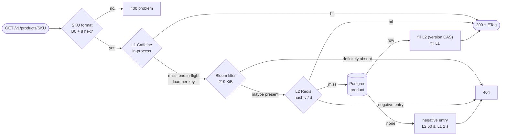
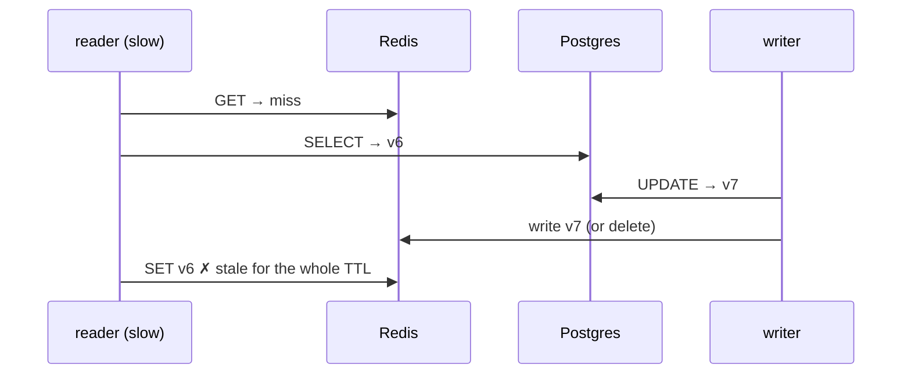

# 01 — Reading a product under a stampede

M1 turns catalog-svc into a real service: 100,000 products in Postgres, a two-level cache in
front of them, OpenSearch for search, and writes guarded by Keycloak roles and HTTP
preconditions. This chapter follows product reads and price changes through it, and then
attacks the cache the three classic ways: a **stampede** (thousands of requests for one key that
just expired), **penetration** (requests for keys that do not exist), and an **avalanche** (many
keys expiring at once).

> Everything below was produced by running the M1 build against the compose infrastructure
> (Postgres 18.6, Redis 8.8.4, OpenSearch 3.9.0, Keycloak 26.8.2) on a MacBook Pro M3 Pro.
> Other builds were running on the machine at the same time (load average 13–40 on 12 cores),
> so **latencies in this chapter are not meaningful**. The experiments count events instead:
> database loads, cache hits, Bloom rejections. Those counts do not depend on machine load.
>
> On this machine, other projects' processes held IPv4 `:8080` and `:9200` (section 8c), so the
> gateway ran on `:18080` and OpenSearch was published on `:9210`. The defaults are still
> 8080 and 9200.

## 1. The read path



Three decisions do most of the work:

- **L1 is an `AsyncCache`.** Concurrent misses for the same key share one `CompletableFuture`,
  so an instance sends at most one load per key downstream at a time, however many requests
  arrive. This is single-flight request coalescing, and Caffeine provides it.
- **The Bloom filter sits below L1 and above Redis.** A SKU that was never created is
  answered without a network call.
- **Every Redis write is a version compare-and-set in Lua.** A writer can never be
  overwritten by a slower reader holding an older version (section 7).

## 2. One SKU, three reads

`B0DAA66D13` is row 3 of the seed (`'B0' || hex(3 × 2654435761 mod 2³²)`). Three reads
through the gateway, with the catalog's own counters before and after each one:

```
$ curl -i localhost:18080/api/v1/products/B0DAA66D13

HTTP/1.1 200 OK
Cache-Control: max-age=5, public
ETag: "1"
Content-Type: application/json
X-Request-Id: 01a1b0b2-976e-7486-96a2-b5d81039fa69

{"sku":"B0DAA66D13","title":"Brightwick Everyday Atlas 103","brand":"Brightwick","category":"Books",
 "price":{"amountCents":16703,"currency":"USD"},"rating":4.8,"version":1,
 "updatedAt":"2026-11-06T11:50:23.237142Z"}
```

| Read | When | L1 hit | L1 miss | `l2_hit` | `db_load` | Served by |
|---|---|---|---|---|---|---|
| — | before | 0 | 0 | 0 | 0 | |
| 1 | t = 0 | 0 | **1** | 0 | **1** | Postgres, then cached in L2 and L1 |
| 2 | right after | **1** | 1 | 0 | 1 | L1 (process memory) |
| 3 | t + 13 s | 1 | **2** | **1** | 1 | L2 (Redis): the L1 entry (10 s ± 20%) had expired, the Redis one (10 min ± 20%) had not |

(`cache_gets_total{cache="catalog.l1"}` comes from Caffeine's statistics via Micrometer;
`catalog_cache_requests_total{outcome=...}` counts what happened below L1.)

The response also carries `Cache-Control: max-age=5, public` and a strong `ETag`. A client or
CDN may reuse it for five seconds, and after that revalidate with `If-None-Match: "1"`, which
costs a `304` with no body.

## 3. What Redis holds

```
$ redis-cli HGETALL cat:p:B0DAA66D13
v
1
d
{"sku":"B0DAA66D13","title":"Brightwick Everyday Atlas 103","brand":"Brightwick","category":"Books",
 "priceCents":16703,"currency":"USD","rating":4.8,"version":1,"updatedAt":"2026-11-06T11:50:23.237142Z"}

$ redis-cli PTTL cat:p:B0DAA66D13
497775
```

The key is a hash, not a string. Field `v` holds the version on its own so the Lua script can
compare it without parsing JSON. A negative entry ("no such SKU") is `v = 0` with empty `d`, and
because 0 is lower than every real version, a negative entry can never overwrite a real
product. The TTL of 497.8 s is 10 minutes scaled by a random factor in [0.8, 1.2] (section 6).

## 4. Stampede: 1,000 requests, one cold key

`tools/bench/cache-experiments.sh` starts catalog-svc in each cache mode, warms it up with 20,000
requests for an unrelated SKU, deletes a SKU's Redis entry, and then has **1,000 virtual threads
request that SKU at the same instant** (`LoadGen` with N = C = 1000). It does this three times
with three different SKUs and reads `db_load` from the service's own metrics.

| Mode | What it is | Database loads, rounds 1 / 2 / 3 |
|---|---|---|
| `NONE` | no cache | 1,000 / 1,000 / 1,000 |
| `NAIVE` | textbook cache-aside on Redis: read Redis, on miss read Postgres and fill Redis | 88 / 151 / 67 |
| `TWO_LEVEL` | the design above | **1 / 1 / 1** |

Why textbook cache-aside still sends dozens to hundreds of requests to the database: every
request that reads Redis before the first database read has come back and filled it sees a
miss. With 1,000 requests released at once, between 67 and 151 of them got there first in
these runs; the rest found the filled entry. In
`TWO_LEVEL`, the first request creates the in-flight future and the other 999 wait on it, so
the window is closed by construction. With N catalog instances the bound becomes N loads per
key, not one; that is good enough, so there is no distributed lock to get wrong.

All 3,000 requests in every mode returned `200`. The burst latencies were similar in every
mode (p50 about 200–350 ms), so on this machine latency does not separate them. The likely
reason, not measured separately, is that accepting 1,000 new connections at once on a
loaded laptop costs more than the local database does. The database load count does
separate the modes, and at Prime Day scale, 1,000 identical queries per expired hot key is
what takes a database down.

## 5. Penetration: 10,000 SKUs that do not exist

The same script then requests 10,000 distinct SKUs `B0F0000000` … `B0F000270F`, 50 at a time:

| Mode | Database loads | Bloom rejections |
|---|---|---|
| `NONE` | 10,000 | — |
| `NAIVE` | 10,000 | — |
| `TWO_LEVEL` | **3** | **9,997** |

Negative caching (what `NAIVE` does) does not help here, because every key is different and
each one is asked for exactly once. An attacker sending random SKUs gets a cache miss every
time. Only a filter over *what exists* stops it.

The three loads that got through deserve a closer look. One of the "nonexistent" SKUs exists:
`B0F0001018` is row 98,200 of the seed ("Everline Classic Lip Balm 200"), and its response was
the single `200` among 9,999 `404`s. So **two** of 9,999 absent SKUs were Bloom false
positives, a measured rate of **0.020%**.

That matches the sizing exactly. The filter is built at startup from the SKUs in Postgres,
sized for 25% growth headroom:

```
SKU Bloom filter ready: 100000 SKUs, 1797199 bits (219 KiB), 10 hashes,
                        target false-positive rate 0.001, built in 205 ms
```

m = −n ln p / (ln 2)² = 1,797,199 bits for n = 125,000 and p = 0.1%, and k = (m / n) ln 2 = 10.
With 100,000 SKUs actually inserted, the expected false-positive rate is
(1 − e^(−kn/m))^k = (1 − e^(−10 · 100,000 / 1,797,199))^10 = **0.020%**. The filter is ours
(`SkuBloomFilter`, about 100 lines with Kirsch–Mitzenmacher double hashing). Redis 8's Bloom
commands would have been an alternative, but the `redis:8.8.4-alpine` image does not include
that module (`ERR unknown command 'BF.RESERVE'`). An in-process filter also answers without
a network round trip.

## 6. Avalanche: keys that expire together

Keys written together, for example on a deploy, a warm-up, or a popular category page, expire
together, and the next second every one of them misses at once. `Ttl.jittered` scales every TTL
by a uniform factor in [1 − 0.2, 1 + 0.2]. 1,000 SKUs warmed into Redis within 2.76 s:

```
PTTL min 477.8 s, max 718.6 s, spread 240.8 s

 8m00s- 8m30s  135 #################################
 8m30s- 9m00s  136 ##################################
 9m00s- 9m30s  116 #############################
 9m30s-10m00s  128 ################################
10m00s-10m30s  134 #################################
10m30s-11m00s  102 #########################
11m00s-11m30s  133 #################################
11m30s-12m00s  116 #############################
```

Without jitter all 1,000 would expire within the same 2.76 s window. With jitter they expire
over four minutes, about four per second. L1 entries (10 s) and negative entries (2 s in L1,
60 s in Redis) are jittered the same way.

## 7. Writing: preconditions, versions, and the race nobody sees

A price change goes through the gateway with a real Keycloak token. The token for `ops`,
decoded:

```json
{
 "iss": "http://localhost:8180/realms/conveyor",
 "aud": "conveyor-api",
 "sub": "5c08ee58-1f04-444b-8bc6-6af6f0f26493",
 "azp": "conveyor-cli",
 "preferred_username": "ops",
 "realm_access": { "roles": ["catalog-admin"] },
 "scope": "profile email"
}
```

Both the gateway and catalog-svc verify the signature (RS256, keys from Keycloak's JWKS), the
expiry, the issuer and the audience. A valid token from the same realm that was issued for
another API is rejected.

The whole exchange for `B078DDE6C4` (row 4, "Juniper Lane Deluxe Blender 104", $131.89, ETag `"1"`):

| Request | Answer | Decided by |
|---|---|---|
| `PUT …/price` without a token | `401`, `WWW-Authenticate: Bearer` | gateway; catalog-svc never saw it (0 log lines for that request id) |
| … with alice's token (role `customer`) | `403`, `Bearer error="insufficient_scope"` | catalog-svc (the gateway only checks that a token is valid) |
| … with ops's token, no `If-Match` | `428 Precondition Required` | catalog-svc |
| … with `If-Match: "1"`, `{"amountCents":1299}` | `200`, `ETag: "2"`, price $12.99 | catalog-svc |
| … the same again, `If-Match: "1"` | `412`, `ETag: "2"`, `"currentVersion":2` | catalog-svc |

```
HTTP/1.1 412 Precondition Failed
ETag: "2"
Content-Type: application/problem+json

{"detail":"The product changed since you read it. Re-read it and retry.",
 "instance":"/api/v1/products/B078DDE6C4/price","status":412,"title":"Precondition Failed",
 "currentVersion":2,"requestId":"01a1b0b3-248b-7e69-919b-8914c3fbfcff",
 "timestamp":"2026-11-06T11:51:32.772051Z"}
```

`428` prevents a blind overwrite, and `412` prevents a lost update. The database is the arbiter:
`UPDATE product SET … version = version + 1 WHERE sku = ? AND version = ?`.

After the `200`, every copy moved to version 2:

```
GET via gateway       ETag "2", price {"amountCents":1299,"currency":"USD"}
redis HGET … v        2
OpenSearch _doc       _version 2, priceCents 1299
redis SUBSCRIBE       message  cat:written  B078DDE6C4:2
```

### The race the version CAS closes

The textbook cache-aside write is "update the database, delete the cache key". It has a known
hole:



Here the reader's last step is the Lua script `PUT_IF_NEWER`. Redis already holds v7, the
script sees 7 ≥ 6, and it does nothing. The writer also *writes* v7 instead of deleting the
key, so a hot SKU does not fall back to Postgres right after every price change.

Redis is not the only copy: every instance has an L1. The writer publishes `SKU:version` on
`cat:written`, and each instance records a per-SKU **version floor**. An L1 entry below the
floor is dropped, and a load that returns a version below the floor (from a Redis write that
was lost, for example) is retried against the database instead of being cached. Both
interleavings are pinned by tests:
`CacheBehaviourTest.aSlowReaderCannotPutAnOlderVersionBackIntoRedis` and
`anAnnouncedNewerVersionForcesAReloadPastAStaleRedisEntry`. If an instance misses a message
entirely, its staleness is bounded by the L1 TTL of 10 s.

The search index follows asynchronously, with the same idea: each document is indexed with
`version_type=external` and the product version, so OpenSearch itself rejects an index request
that arrives after a newer one. `SearchApiTest` sends an out-of-order v1 after v2 and checks
the index still shows v2.

## 8. What the real run found

The unit and Testcontainers suites were green before any of this ran. Running against the
real infrastructure still found these problems; each fix came with a test where one was
possible.

### 8a. A Redis blip at startup killed the service

Under load, catalog-svc failed to start with `Failed to start bean 'productWrittenListener'
… Unable to connect to Redis`. A plain `RedisMessageListenerContainer` bean subscribes
during startup, and one failed connection attempt aborts the whole application, even though
the read path can run without Redis.

The subscription is now `ProductWrittenSubscription`, which connects in the background with
exponential backoff. To verify it, catalog-svc was started with Redis stopped:

```
readiness                         {"status":"UP"}
GET /v1/products/B09E3779B1       200     (l2_error 1, db_load 1: served from Postgres)
GET (again)                       200     in 5.9 ms (L1)
catalog_cache_subscription_connected 0.0

WARN … subscription to cat:written failed (attempt 1), retrying in 500 ms
WARN … subscription to cat:written failed (attempt 2), retrying in 1000 ms
… redis started …
WARN … subscription to cat:written failed (attempt 5), retrying in 8000 ms
INFO … subscribed to cat:written after 6 attempt(s)
catalog_cache_subscription_connected 1.0
```

### 8b. Keycloak's realm import silently stripped the tokens

The first tokens from the imported realm had no `sub`, no `preferred_username`, and no
`realm_access`. Every role check would have failed. The cause was a top-level `clientScopes`
array added to the realm file for the audience mapper. Keycloak treats that array as the
complete set of client scopes, so the built-in `basic`, `profile` and `roles` scopes were never
created. The audience mapper now sits on each client, and the compose file warns against
reintroducing the array.

### 8c. Same URL, two different servers

The search backfill failed 30 times with `Unrecognized token 'Error'`, although `curl
localhost:9200` answered as OpenSearch. `lsof` showed why:

```
cart-svc   43407  IPv4  TCP 127.0.0.1:9200 (LISTEN)     ← another project on this machine
com.docker 45377  IPv6  TCP *:9200 (LISTEN)             ← OpenSearch
```

Java resolves `localhost` to 127.0.0.1 first and reached the other process. curl tries `::1`
first and reached Docker. The host port is now configurable (`CONVEYOR_OPENSEARCH_PORT`,
`CONVEYOR_OPENSEARCH_URL`).

Port 8080 was worse. Another project's gateway held IPv4 `*:8080`, and Conveyor's gateway
still started without an "address in use" error, because macOS let it bind IPv6 `*:8080`
next to it:

```
gateway 45607 IPv4 *:8080        ← build/release/src/gateway/gateway (another project)
java    68271 IPv6 *:8080        ← Conveyor gateway

curl -4 127.0.0.1:8080/actuator/health  → 404, X-Request-Id: gw-1f90-c360
curl -6 [::1]:8080/actuator/health      → 200
```

The difference in request-id format (`gw-…` instead of a UUIDv7) gave it away. The other process
started at 02:46 local time, after chapter 00's laptop measurements (01:40–02:10), so those
measurements are unaffected.

### 8d. The gateway dropped the forwarded prefix

Problem bodies from catalog-svc named the internal path (`"instance":"/v1/products/…"`), which
chapter 00 left open. The fix is the standard one: services honour `X-Forwarded-Prefix`
(`server.forward-headers-strategy=framework` in the platform defaults). But Spring Cloud
Gateway 5 sent no such header, and even a header added by our own route filter disappeared
on the way out. With `trusted-proxies` unset, the gateway writes no X-Forwarded headers and
removes any that are present. It now trusts only the load balancer's range (locally: nobody),
so it discards whatever a client sent and writes its own `X-Forwarded-Prefix: /api`. The
gateway itself sets `forward-headers-strategy: none`, because the edge must not believe a
client. Now:

```
{"detail":"No product with SKU B0FFFFFFFF.","instance":"/api/v1/products/B0FFFFFFFF","status":404,…}
```

`GatewayRoutingTest.clientCannotSpoofTheForwardedPrefix` sends `X-Forwarded-Prefix: /evil` and
checks that the service receives `/api`.

### 8e. Facets exposed a bad seed

The first search for "pour-over kettle" returned products from only three of the twelve brands.
Every column of the synthetic seed was derived from the same hash as the SKU, so the columns
were correlated. Each attribute now uses its own multiplicative hash, and kettles spread over
all twelve brands (180–240 each). The data in this chapter is from the fixed seed.

### 8f. Smaller ones

- Redis 8's official Alpine image does not include the Bloom module (section 5).
- Spring Security 7 adds a `FACTOR_BEARER` authority to every JWT authentication, which
  `KeycloakRealmRolesTest` first failed on. It records which authentication factor was used,
  for multi-factor rules.
- Authentication errors written by a servlet filter came out as
  `application/problem+json;charset=UTF-8`, unlike every other error. They are now written as
  UTF-8 bytes with the plain media type.
- The first request carrying a token costs extra: the issuer is discovered lazily (so services
  start without Keycloak), and the OIDC discovery plus JWKS fetch landed on that request
  (972 ms at the gateway and 402 ms in catalog-svc on this machine).

## 9. Search

```
GET /api/v1/search?q=pour-over%20kettle&size=3

total 2499   tookMillis 104
  B0DEE35D39 | Harborlight Ultra Pour-Over Kettle 985    | Home & Kitchen | 1647  | score 14.18
  B0DF0B6DF9 | Harborlight Everyday Pour-Over Kettle 117 | Home & Kitchen | 7358  | score 14.18
  B0DF3A2399 | Harborlight Classic Pour-Over Kettle 581  | Home & Kitchen | 15338 | score 14.18
  facet category [('Home & Kitchen', 2499)]
  facet brand    [('Fernhollow', 240), ('Brightwick', 239), ('Kestrel', 227), ('Ironbark', 224), …]

GET /api/v1/search?q=kettle&brand=Kestrel&maxPriceCents=2500&size=3

total 21   tookMillis 33
```

Queries go to the alias `products`, and documents live in `products-v1` behind it, so a future
mapping change can build `products-v2` and move the alias without downtime. The backfill
indexed 100,000 documents (10.9 MB) in 7–12 s, in the background, while the service was already
serving product reads. A search outage answers `503` with `Retry-After`; product pages do not
depend on search.

## 10. What it costs to run

| | Memory |
|---|---|
| OpenSearch, 100k documents | 976 MiB (the 1 GiB limit was too tight; now 1.5 GiB) |
| Keycloak (dev mode) | 626 MiB |
| Kafka | 511 MiB |
| Postgres pg-0 / pg-1 | 97 / 28 MiB |
| Redis, ~1k cached products | 16 MiB |
| catalog-svc JVM | 374 MB footprint (heap in use 59 MiB, non-heap 133 MiB) |
| gateway JVM | 271 MB footprint (heap in use 92 MiB, non-heap 80 MiB) |

## Reproduce

```bash
./gradlew build                                   # 102 tests; catalog-svc's use Testcontainers
make infra-up PROFILES="search auth"              # core + OpenSearch + Keycloak (realm imported)
java -jar services/catalog-svc/build/libs/catalog-svc.jar &
java -jar services/gateway/build/libs/gateway.jar &

curl -i localhost:8080/api/v1/products/B0DAA66D13
docker exec conveyor-redis-1 redis-cli HGETALL cat:p:B0DAA66D13

TOKEN=$(curl -s localhost:8180/realms/conveyor/protocol/openid-connect/token \
  -d grant_type=password -d client_id=conveyor-cli -d username=ops -d password=ops | jq -r .access_token)
curl -i -X PUT localhost:8080/api/v1/products/B078DDE6C4/price -H "Authorization: Bearer $TOKEN" \
  -H 'If-Match: "1"' -H 'Content-Type: application/json' -d '{"amountCents":1299}'

JAVA=/path/to/jdk-25/bin/java tools/bench/cache-experiments.sh   # sections 4 and 5
```
