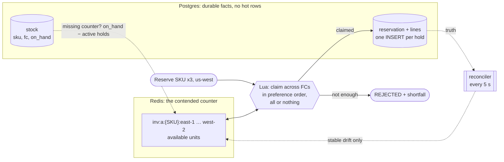

# 03 — 10,000 buyers, one SKU

A deal starts at 09:00. Ten thousand buyers press "buy" on the same product within a few
seconds, and there are 6,000 units in six fulfillment centers. Every unit must be sold once,
none twice, and the buyers who lose should hear "sold out" quickly instead of waiting on a
timeout.

M3 adds inventory-svc: available stock per (SKU, FC), and the Reserve / Commit / Release
protocol the order saga will call over gRPC. This chapter first follows single reservations
through it. It then compares four ways to sell one hot SKU on a clean machine, and puts the
real service under a 10,000-buyer burst. The first version of the service failed that burst
badly, and the chapter shows why.

> Benchmarks ran on GitHub-hosted runners (4 vCPUs; the CPU model is printed with each result),
> where no other workload shares the machine. The functional walkthroughs ran on the M3 Pro
> laptop against compose infrastructure (Postgres 18.6, Redis 8.8.4). The laptop's load
> average swung between 10 and 211 from other builds that day, so its timings are not quoted.

## 1. The model



The truth is always in Postgres: `available = on_hand − Σ(held + committed)`. `stock` changes
only on restock and shipment, so it is never a hot row. A hold is an INSERT into
`reservation`, so ten thousand buyers never queue on the same row lock. The only thing all
buyers of one SKU have to agree on is the counter, and that lives in Redis, where a Lua script
runs to completion before the next one starts.

Keys are `inv:a:{SKU}:FC`. The braces are a Redis Cluster hash tag: all six FCs of a SKU land in
one slot, so the multi-FC allocation stays one atomic script on a cluster too.

## 2. One reservation

The seed stocks 100,000 SKUs over six FCs (287,641 rows, 28.7 million units). Rows 1–10 are deal
SKUs with 1,000 units in every FC. Before:

```
GET /v1/inventory/B09E3779B1
{"sku":"B09E3779B1","available":6000,"fcs":[{"fcId":"east-1","region":"us-east","onHand":1000,"available":1000}, … ]}
```

A customer in us-west reserves three (`tools/grpc/InventoryClient.java`):

```
reservation_id: "1e46414a-e66f-4ca1-bc1e-62903466a728"
status: RESERVATION_STATUS_HELD
allocations { sku: "B09E3779B1" fc_id: "west-1" quantity: 3 }
expires_at { seconds: 1793984524 nanos: 63223000 }

redis  inv:a:{B09E3779B1}:west-1 = 997   (east-1, east-2, central-1, south-1, west-2 = 1000)
```

west-1 was chosen because FCs in the customer's region come first (west-1, then west-2), and
then the rest by fallback rank. When the first FC runs short, a line is split. `B001AA5314` has
1 unit in east-1 and 132 in east-2, and a us-east customer asks for 4:

```
allocations { sku: "B001AA5314" fc_id: "east-1" quantity: 1 }
allocations { sku: "B001AA5314" fc_id: "east-2" quantity: 3 }

 reservation_id                       | sku        | fc_id  | quantity
 f725106c-d1be-4508-80fc-b4a76b2c23b4 | B001AA5314 | east-1 |        1
 f725106c-d1be-4508-80fc-b4a76b2c23b4 | B001AA5314 | east-2 |        3
```

The rest of the protocol, on the first reservation:

| Call | Answer | west-1 counter |
|---|---|---|
| `Commit` | `COMMITTED` (payment captured; units stay out of sellable stock) | 997 |
| `Release` | `RELEASED` (order cancelled after payment) | 1000 |
| `Release` again | `RELEASED`, units **not** returned twice | 1000 |

`B000172DB5` has 59 units (2 in east-1, 57 in west-2). Asking for 100 is a business outcome, not
an error:

```
status: RESERVATION_STATUS_REJECTED
shortfalls { sku: "B000172DB5" quantity: 100 }
availability after: sellable 59        (nothing was claimed)
```

A reservation is all-or-nothing: if one line cannot be served, the lines that could have been
are given back. Holds that are neither committed nor released expire. A 60 s hold on
`B0DAA66D13` expired at 17:29:17.95, and the sweeper (every 5 s, `FOR UPDATE SKIP LOCKED` so
several instances can sweep at once) returned its units at 17:29:21.8.

## 3. Four ways to sell one SKU

`HotSkuBenchmark` gives each strategy one SKU with 10,000 units and 20,000 attempts to buy one
unit each (so it also measures the sold-out phase), spread over 16, 64 or 256 concurrent
buyers, with a 32-connection Postgres pool. Every attempt claims a unit and records a
reservation row. After every run, the harness checks that reservation rows, claimed units and
the counter all agree:

- `ROW_LOCK`: `SELECT … FOR UPDATE` on the SKU's row, `UPDATE reserved`, `INSERT`, `COMMIT`.
- `CONDITIONAL`: `UPDATE … SET reserved = reserved + 1 WHERE reserved < on_hand`, `INSERT`,
  `COMMIT`.
- `BUCKETS`: stock split over 16 rows; the conditional UPDATE goes to a random bucket (the
  others are tried if it is empty), then `INSERT`, `COMMIT`.
- `REDIS`: a Lua decrement, then the `INSERT` as its own transaction (given back on failure).
  This is what inventory-svc does.

Units sold per second until sold out, two rounds each (`tools/bench/hot-sku-matrix.sh` on an
Intel Xeon Platinum 8573C runner):

| Strategy | 16 buyers | 64 buyers | 256 buyers |
|---|---|---|---|
| `ROW_LOCK` | 1,279 / 1,598 | 1,373 / 1,349 | 1,354 / 1,340 |
| `CONDITIONAL` | 1,849 / 1,836 | 1,529 / 1,529 | 1,518 / 1,516 |
| `BUCKETS` (16) | 5,496 / 5,695 | 4,648 / 5,138 | 4,955 / 4,813 |
| `REDIS` | **6,502 / 6,623** | **7,229 / 6,907** | **8,095 / 7,796** |

p99 latency of one attempt, in ms:

| Strategy | 16 buyers | 64 buyers | 256 buyers |
|---|---|---|---|
| `ROW_LOCK` | 49 / 41 | 281 / 272 | 1,911 / 1,899 |
| `CONDITIONAL` | 32 / 32 | 273 / 269 | 1,670 / 1,808 |
| `BUCKETS` (16) | 12 / 13 | 333 / 340 | 2,456 / 2,227 |
| `REDIS` | **7 / 6** | **25 / 25** | **83 / 90** |

All 24 runs: 10,000 sold, 10,000 rejected, zero errors, and `no oversell, counters agree`.

What the numbers say:

- **One row is one queue.** `ROW_LOCK` and `CONDITIONAL` stay at 1,300–1,850 units/s whatever the
  concurrency. Both hold the SKU's row lock from their UPDATE until COMMIT, and COMMIT includes
  the WAL flush, so roughly one reservation commits at a time. Adding buyers only lengthens
  the queue: p99 goes from about 40 ms to about 1.9 s. `CONDITIONAL` is faster only at low
  concurrency, by saving one round trip while holding the lock.
- **Sixteen rows are sixteen queues.** `BUCKETS` sells 3–4× faster than one row. Its weak spot
  is the end of the sale: once buckets run dry, a buyer may try several before finding stock,
  and every rejection after the sell-out scans all 16. It sold out in about 2 s and then spent
  another 4.5 s turning the remaining 10,000 buyers away, and its p99 at 256 buyers was the
  worst of all. A production version would need an in-memory "sold out" flag and a bucket
  map, which is a cache in front of the database again.
- **No contended row at all.** `REDIS` serializes buyers in memory, in microseconds per script,
  and gets *faster* with more buyers (6.5k → 8.1k units/s). The likely reason, not measured
  separately: with nobody waiting on a lock, more INSERTs commit at once and Postgres can
  flush them together (group commit). What remains per sale is one uncontended INSERT. Rejections cost one script and no database work: all 20,000 attempts
  finished in 1.5–1.8 s, against 6–9 s for the others.

The price is that the counter and the truth live in different systems, so they can drift.
Section 5 covers what happens then.

## 4. The service under a burst

The harness measures the claim primitive. The service adds gRPC, idempotency lookups, rejection
rows, the region preference and FC splits on top. `tools/bench/service-burst.sh` starts
inventory-svc, and `InventoryClient burst` has 10,000 virtual-thread clients reserve one unit
of a deal SKU (6 × 1,000 units) at the same instant.

### 4a. The first version failed 45% of the buyers

Run on the laptop, against the first version of the service:

```
10000 buyers for B03C6EF362 from us-east: {HELD=3951, REJECTED=1513}, errors 4536, all answered after 21.87 s

service log:  4532 x inventory dependency failed: QueryTimeoutException: Redis command timed out
                 4 x CannotGetJdbcConnectionException
available after the burst: 0       units held in Postgres: 3951
```

No unit was oversold: 3,951 holds for 6,000 units, because the gate cannot go below zero. But **2,049
units were neither sold nor sellable**, and 1,513 buyers were told "sold out" while those units
existed. Two things combined:

- gRPC's default executor is a cached pool of *platform* threads. The failed calls alone ran
  on 1,182 distinct `grpc-default-executor-N` threads.
- Every one of 10,000 calls queued its script on the same Redis connection at once. The queue
  outgrew the 250 ms command timeout. A timed-out claim had often already executed in Redis, so
  the unit was claimed and no reservation was written.

The reconciler (section 5) restored all of it once the counters were quiet:

```
08:53:39.475 repaired inv:a:{B03C6EF362}:south-1:   counter 0 vs truth 235, corrected by 235
08:53:39.487 repaired inv:a:{B03C6EF362}:east-1:    counter 0 vs truth 244, corrected by 244
08:53:39.501 repaired inv:a:{B03C6EF362}:west-2:    counter 0 vs truth 976, corrected by 976
08:53:39.514 repaired inv:a:{B03C6EF362}:west-1:    counter 0 vs truth 282, corrected by 282
08:53:39.528 repaired inv:a:{B03C6EF362}:central-1: counter 0 vs truth 312, corrected by 312
available now: 2049
```

### 4b. A bulkhead, and clients that back off

Three changes:

- gRPC handlers run on virtual threads (`GrpcServerConfiguration`).
- `ReservationAdmission` is a bulkhead in front of Reserve: at most 64 calls in flight, up to
  500 ms of waiting for a slot, then `RESOURCE_EXHAUSTED`. The refusal comes before anything is
  claimed, so a retry is always safe.
- Clients retry `RESOURCE_EXHAUSTED` and `UNAVAILABLE` with exponential backoff and full jitter
  (Builders' Library), with the same idempotency key every time.

To see what the bulkhead alone does, `service-burst.sh` ran on clean runners with the bulkhead
on (64) and effectively off (100,000). Everything else was identical: two bursts of 10,000
buyers, each on a fresh deal SKU with 6,000 units. Runners are assigned by GitHub, so the CPU
differs per run and is listed.

| Bulkhead | Runner CPU | Burst | Held | Rejected | Errors | Units stranded | Answered after |
|---|---|---|---|---|---|---|---|
| off | AMD EPYC 7763 | 1 (cold) | 3,342 | 5,189 | 1,469 | 2,658 | 18.2 s |
| off | AMD EPYC 7763 | 2 | 5,794 | 4,094 | 112 | 206 | 7.9 s |
| **on** | Intel Xeon 8573C | 1 (cold) | **6,000** | **4,000** | **0** | **0** | 15.4 s |
| **on** | Intel Xeon 8573C | 2 | **6,000** | **4,000** | **0** | **0** | 7.7 s |
| **on** | AMD EPYC 9V74 | 1 (cold) | **6,000** | **4,000** | **0** | **0** | 14.9 s |
| **on** | AMD EPYC 9V74 | 2 | **6,000** | **4,000** | **0** | **0** | 6.8 s |

Without the bulkhead, the service log of that run holds 14,825 Redis command timeouts and
2,217 `Failed to obtain JDBC Connection`. Both are returned as `UNAVAILABLE`, which the clients
retried, and 1,469 + 112 calls still ended with a status the client does not retry. The
stranded units came back through the reconciler once the burst was over (available afterwards:
2,658 and 206, exactly the gap). By then 5,189 buyers had already been told the deal was sold out.

With the bulkhead, every Redis call stayed far below its timeout (0 timeouts in the log), and
the reconciler had nothing to repair. Refusals happened at the door: 37,455 and 13,325
`RESOURCE_EXHAUSTED` on the Xeon run, never in the middle of a claim. Every buyer got a
definitive answer, and exactly 6,000 of them got a unit.

The price is waiting. Time to a final answer is mostly backoff: a median of 10.8 s on the cold
first burst and 5.2 s on the warm second. About 1,300 final answers per second on the warm
bursts (half that cold), from one instance on 4 vCPUs, is well below the ~7,000 units/s of the
bare primitive in section 3. Each call here does more: an idempotency lookup, gRPC, a `REJECTED` row for every
losing buyer (it is what makes their retries idempotent), and the 10,000-thread client shares
the same 4 vCPUs. Adding instances adds bulkheads; that is not measured here.

## 5. Keeping Redis honest

Two kinds of drift exist, and they are not equally bad.

**Counter too low: undersell.** A process dies between the Redis claim and the reservation
INSERT, or between a release in Postgres and the one in Redis, or a command times out after it
ran. The reconciler compares the counter of every recently touched (SKU, FC) with the truth.
While a claim is in flight, the counter is also briefly lower than the truth. So the reconciler
repairs a difference only when it is *stable*: the same counter, the same truth and the same
difference on two passes in a row. Live, simulating a crash after a claim:

```
09:29:44 redis-cli DECRBY inv:a:{B0DAA66D13}:south-1 7         → 993 (claimed, no reservation)
09:29:53 repaired inv:a:{B0DAA66D13}:south-1: counter 993 vs truth 1000, corrected by 7
```

A counter that keeps moving is left alone until it is quiet (`StockConsistencyTest.aBusyCounterIsNotTouched`).
Because the correction is relative (`INCRBY`), it stays exact even if a buyer claims between the
check and the fix.

**Counter too high: oversell.** Redis appends to its AOF and fsyncs once per second. A crash
can lose the last second of decrements, and when Redis comes back its counters claim units
that are already held. Waiting for a stable drift would sell those units twice. So the
reconciler watches Redis's `run_id`, and when it changes it drops every counter. They are
rebuilt from Postgres on next use:

```
09:29:56 docker restart conveyor-redis-1
09:29:58 Redis restarted (run_id e7afe70e…ad97 -> 210462d6…77c1): dropped 30 stock counters; they rebuild from Postgres
rebuilt from Postgres: {east-1: 1000, east-2: 1000, central-1: 1000, south-1: 1000, west-1: 1000, west-2: 1000}
```

The rebuild itself was a stampede in the first version: a thousand buyers found the counters
missing at once and every one ran the truth query. `StockConsistencyTest` failed with pool and
Redis timeouts, and initialization is now coalesced per SKU (one query, the others wait for it).

## 6. What it costs to run

The new service adds one JVM (gRPC on 9083, HTTP on 8083) and nothing to the infrastructure:
it uses the `inventory` database on pg-0 and the existing Redis. For 100,000 SKUs × the touched
FCs, counters exist only for SKUs that someone has looked at.

## Reproduce

```bash
./gradlew build                                   # inventory-svc: 19 tests, incl. 1,000 buyers for 100 units
make infra-up
java -jar services/inventory-svc/build/libs/inventory-svc.jar &
java -Djarmode=tools -jar services/inventory-svc/build/libs/inventory-svc.jar extract --destination build/inventory-svc-extracted
CP='build/inventory-svc-extracted/inventory-svc.jar:build/inventory-svc-extracted/lib/*'
java -cp "$CP" tools/grpc/InventoryClient.java localhost:9083 reserve us-west B09E3779B1:3
java -cp "$CP" tools/grpc/InventoryClient.java localhost:9083 burst B03C6EF362 10000 us-east

# On a clean machine (or: Actions → bench → Run workflow):
tools/bench/hot-sku-matrix.sh                     # section 3
MAX_IN_FLIGHT=64 tools/bench/service-burst.sh     # section 4b; MAX_IN_FLIGHT=100000 turns the bulkhead off
```
