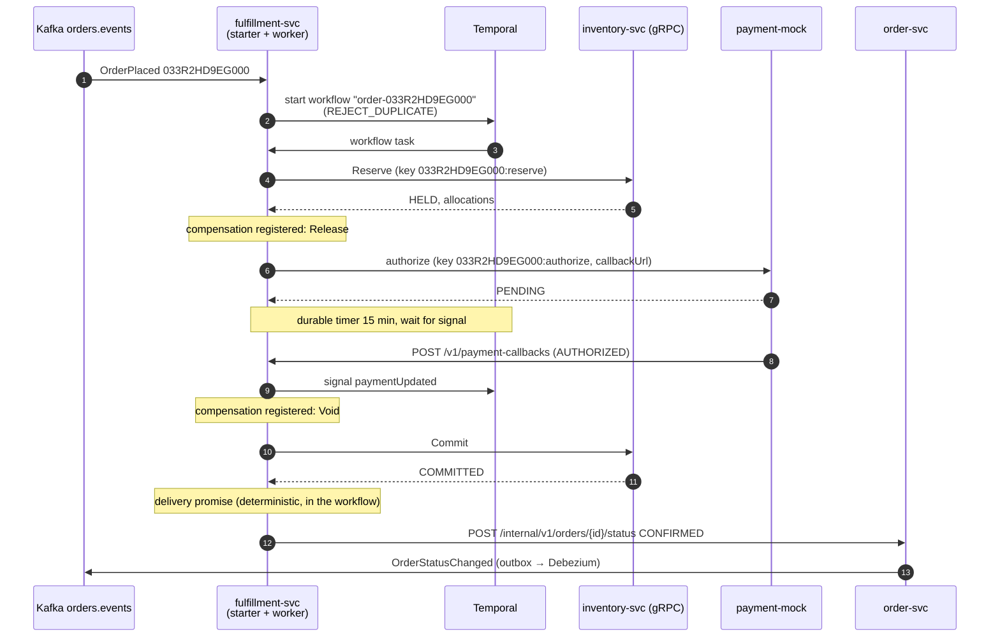

# 04 — The saga, step by step and failure by failure

An order that has been placed is only a promise. Before the customer sees "confirmed", stock has
to be held in a fulfillment center, the card has to be authorized, the hold has to become a pick
obligation, and the customer needs a delivery date. These steps live in three services and can
take seconds or, when a bank asks for 3-D Secure, minutes. Any one of them can fail, and a failure
halfway through must not leave stock held for nobody or money held for nothing.

M4 adds fulfillment-svc. It runs that sequence as a saga on Temporal: one workflow per order,
started from the `OrderPlaced` event, with a compensation for every step that changed something.
It also adds payment-mock, a payment provider whose failures can be triggered on purpose. This
chapter follows four orders through the saga, one for each way it can end. Then it kills the
worker in the middle of a saga, replays every event on the topic, and checks what survived.

> Everything below ran on the M3 Pro laptop against compose infrastructure (Postgres 18.6, Redis
> 8.8.4, Kafka 4.4, Debezium 3.7, Temporal dev server 1.10 / SDK 1.40). Other builds kept the load
> average between 33 and 38 during the run, so durations are shown to make the order of events
> clear. They are not latency claims.

## 1. The shape



The workflow is ordinary Java (`OrderFulfillmentWorkflow`). Temporal records every step's result
in the workflow's event history. If a worker dies, another worker replays that history and the
code continues from the same point. That rule decides what goes where:

| Belongs in | What | Why |
|---|---|---|
| Activity (`FulfillmentActivitiesImpl`) | gRPC to inventory, HTTP to payment and order-svc | Side effects. Retried by Temporal with backoff (0.5 s, ×2, max 10 s; 5 min total) |
| Workflow | Order of steps, compensations, the 15-minute wait, the delivery promise | Must be deterministic. `DeliveryPromise.estimate` uses `Workflow.currentTimeMillis()`, never `Instant.now()` |

Each activity is safe to run twice. Its idempotency key is built from the order id, so retrying
after a lost response repeats the original answer instead of acting a second time:

| Step | Key | Compensation |
|---|---|---|
| Reserve | `<orderId>:reserve` | Release (`<reservationId>:release`) |
| Authorize | `<orderId>:authorize` | Void |
| Commit | `<reservationId>:commit` | — (the last step that can fail) |
| Update order | `UPDATE … WHERE status = 'PLACED'`; a repeat answers 200, a different final status 409 | — |

## 2. Four orders, four endings

payment-mock picks its answer from the amount, so each scenario can be reproduced on demand:
amounts ending in **13** cents are declined, and amounts ending in **37** cents go PENDING and
are approved by a callback later. The no-stock order uses a SKU the seed leaves at zero units.

```
happy            POST -> 201 033R2D31PG000 total=17600
pending (..37)   POST -> 201 033R2D3GTG000 total=9837
declined (..13)  POST -> 201 033R27RDYG000 total=9413
no stock         POST -> 201 033R2F0KJG000 total=29604

happy            033R2D31PG000 -> CONFIRMED       after  2.55s  promised=2026-11-08T21:00:00Z v=2
pending (..37)   033R2D3GTG000 -> CONFIRMED       after  4.56s  promised=2026-11-08T21:00:00Z v=2
declined (..13)  033R27RDYG000 -> PAYMENT_FAILED  after 12.46s  reason='card declined' v=2
no stock         033R2F0KJG000 -> REJECTED        after  1.07s  reason='out of stock: [B0D0BE6C93x2]' v=2
```

`after` runs from the POST to the moment `GET /v1/orders/{id}` stopped showing PLACED. It
includes the outbox → Debezium → Kafka hop before the saga even starts. Every order ends at
`version 2`: one PLACED write, one status change.

The declined order, from all three services' logs merged by time:

```
14:03:47.261 [fulfillment-svc] OrderPlacedStarter: saga started for order 033R27RDYG000
14:03:51.873 [payment-mock]    PaymentController: DECLINED auth-919b078e-… for order 033R27RDYG000 (9413 cents)
14:03:55.943 [order-svc]       access: POST /internal/v1/orders/033R27RDYG000/status -> 200 in 303155 us
14:03:55.992 [fulfillment-svc] FulfillmentActivitiesImpl: order 033R27RDYG000 -> PAYMENT_FAILED
```

Between the decline and the status change, the saga ran the Release compensation, so the held
unit went back on sale before the customer was told. The workflow tests pin each ending to the
exact sequence of calls (`OrderFulfillmentWorkflowTest`):

| Scenario | Calls, in order | Outcome |
|---|---|---|
| Happy path | reserve, authorize, commit, update | CONFIRMED |
| No stock | reserve, update | REJECTED (payment never touched) |
| Card declined | reserve, authorize, **release**, update | PAYMENT_FAILED |
| Payment provider 500 ×3 | reserve, authorize ×4, commit, update | CONFIRMED (Temporal retried, not our code) |
| PENDING, callback after 3 min | reserve, authorize, *wait*, commit, update | CONFIRMED |
| PENDING, no callback | reserve, authorize, *15 min*, **release**, update | CANCELLED |
| Hold expired before commit | reserve, authorize, commit=EXPIRED, **void, release**, update | CANCELLED |
| Same order started twice | second start throws `WorkflowExecutionAlreadyStarted` | one saga |

Compensations run in reverse order: the payment is voided before the stock is released. The
tests use Temporal's time-skipping test server, so the 15-minute timeout case finishes in
milliseconds. All eight cases took 17.7 s, most of it starting the test server.

### The delivery promise

The rule is deliberately small. If every unit ships from an FC in the customer's region, the
order arrives at 21:00 UTC two days later. Otherwise it takes four days. The pending order above
shipped to `us-west` from a west FC and got the two-day promise, the same as the `us-east` order.
Because the workflow computes the promise from its own clock, a replay after a crash produces
the same date.

## 3. A durable wait, and a worker that dies during it

A PENDING payment usually means a customer looking at a bank's 3-D Secure page. Holding a thread
for that is wasteful, and a delay queue needs its own store and its own sweeper. In the workflow
it is one line:

```java
boolean completed = Workflow.await(PAYMENT_WINDOW, () -> paymentUpdate != null);
```

To show that the wait lives in Temporal and not in the JVM, payment-mock was set to call back
after 150 s. One pending order went in, and fulfillment-svc was killed with `kill -9` during the
wait:

```
order 033R2HD9EG000 placed at 14:05:03
14:05:05 saga: {"orderId":"033R2HD9EG000","stage":"waiting for payment"}
14:05:05 fulfillment-svc killed (-9)
14:05:32 restarted
14:06:01 up; saga: {"stage":"waiting for payment","orderId":"033R2HD9EG000"}
14:07:38 order 033R2HD9EG000 -> CONFIRMED
```

The workflow's event history, as recorded by Temporal (`temporal workflow show`). Times are
relative to the start:

```
  1 +   0.000s WORKFLOW_EXECUTION_STARTED
  5 +   0.435s ACTIVITY_TASK_SCHEDULED Reserve
  7 +   0.865s ACTIVITY_TASK_COMPLETED
 11 +   0.960s ACTIVITY_TASK_SCHEDULED Authorize
 13 +   1.229s ACTIVITY_TASK_COMPLETED
 17 +   1.345s TIMER_STARTED 900s                  <- worker killed, restarted; nothing here
 18 + 152.098s WORKFLOW_EXECUTION_SIGNALED paymentUpdated
 22 + 152.443s TIMER_CANCELED
 23 + 152.444s ACTIVITY_TASK_SCHEDULED Commit
 25 + 152.661s ACTIVITY_TASK_COMPLETED
 29 + 152.715s ACTIVITY_TASK_SCHEDULED UpdateOrder
 31 + 153.201s ACTIVITY_TASK_COMPLETED
 35 + 153.255s WORKFLOW_EXECUTION_COMPLETED
```

(Workflow-task events omitted; 35 events in all.) Nothing appears in the 151 seconds between
events 17 and 18. The process that started the timer was dead for half of that time, and it did
not matter. The timer belongs to the Temporal server. The new worker picked up the workflow when
the signal arrived, replayed events 1–17 without calling inventory or payment again, and
continued with Commit.

## 4. Every event, delivered again

Kafka delivers at least once, and Debezium re-sends after a restart. The starter keeps no state
of its own. Temporal's workflow id is the dedup key: `order-<orderId>` with
`REJECT_DUPLICATE`, so a second start for the same order fails with
`WorkflowExecutionAlreadyStarted`, and the starter counts it as a duplicate and acknowledges it.

To test this, fulfillment-svc was stopped, its consumer group was reset to the earliest offset,
and the service was started again:

```
fulfillment_sagas_started_total{outcome="duplicate"} 80.0
fulfillment_sagas_started_total{outcome="started"} 0.0
records on orders.events: 160
```

It read 160 records: 80 `OrderPlaced` and the 80 `OrderStatusChanged` the sagas themselves
caused. The starter skips status changes. All 80 `OrderPlaced` events were refused as
duplicates, and nothing ran twice. `temporal workflow list` still showed exactly 80 workflows,
all `COMPLETED`.

The first attempt at this replay did nothing. It ran 12 seconds after the `kill -9`, and the dead
consumers were still members of the group, because the broker drops them only after the session
timeout. `kafka-consumer-groups --reset-offsets` refuses to touch a group with members. The
service restarted at its old offsets and reported `duplicate 0, started 0`. The second attempt
used a graceful stop (the consumers leave the group) and worked.

## 5. The backlog nobody planned for

The first start of fulfillment-svc found 75 orders already on the topic. They were placed in M2,
before any saga existed. The consumer group was new, so `auto-offset-reset: earliest` gave it
the whole topic, and within a minute all 75 had been reserved, authorized, committed and
confirmed:

```
fulfillment_sagas_started_total{outcome="started"} 75.0
  75 CONFIRMED
```

That was the right outcome, since those orders had been stuck in PLACED. It also shows what
earliest means on a real cluster. A new consumer group processes the topic's entire retention
window. Pointing a fresh deployment at production with that setting would re-fulfill every
order in it, unless the starter deduplicates, which this one does through the workflow id.

While the backlog ran, the worker logged

```
WARN i.t.internal.worker.ActivityWorker : Failure during reporting of activity result to the server.
  ActivityType = Reserve, WorkflowId=order-033M1KHTEG000 …
```

a few times. The Temporal dev server (SQLite, 384 MB limit) was answering slowly on a loaded
machine. Reporting a result is retried. If the report is lost for good, the activity times out
and runs again, which the idempotency keys make harmless. All 75 sagas completed.

## 6. What the real run broke

- **Temporal did not start.** The container exited with `unable to open database file (14)`.
  The image runs as uid 1000, and the named volume was mounted at a new path, `/var/temporal`,
  which Docker creates owned by root. Mounting the volume over the user's home directory
  (`/home/temporal`) fixed it, because a new named volume copies the ownership of the directory
  it covers.
- **`GET /v1/sagas/{id}` answered 500** when polled before the `OrderPlaced` event had arrived,
  because `WorkflowNotFoundException` was not handled. It now answers 404. A late payment
  callback for a saga that is gone answers 410. Both are covered by
  `PaymentCallbackControllerTest`.
- **The first orders of the run got 503.** catalog-svc had just started and needed 1.1 s for a
  cold lookup, which is longer than order-svc's pricing deadline, so order-svc refused the order.
  It did not time out silently or guess a price. The retry seconds later hit the cache.
- **The offset reset after `kill -9` was refused**, as described in section 4.

## Reproduce

```bash
./gradlew :services:fulfillment-svc:build          # 8 saga tests on the time-skipping server, plus contract tests
make infra-up PROFILES="search auth events workflow"
for s in catalog-svc order-svc inventory-svc payment-mock fulfillment-svc; do
  java -jar services/$s/build/libs/$s.jar & done
make connectors

TOKEN=$(curl -s localhost:8180/realms/conveyor/protocol/openid-connect/token \
  -d grant_type=password -d client_id=conveyor-cli -d username=alice -d password=alice | jq -r .access_token)
# amount ending in .37 -> PENDING, approved by callback after callbackDelayMs
curl -X PUT localhost:8086/v1/admin/behaviour -H 'Content-Type: application/json' \
  -d '{"declineRate":0,"errorRate":0,"latencyMs":0,"callbackDelayMs":150000}'
curl -X POST localhost:8082/v1/orders -H "Authorization: Bearer $TOKEN" \
  -H "Idempotency-Key: saga-$(date +%s)" -H 'Content-Type: application/json' \
  -d '{"items":[{"sku":"B0DEF2D107","quantity":1}],"shipToRegion":"us-central"}'
curl localhost:8084/v1/sagas/<orderId>             # {"stage":"waiting for payment"}
docker exec conveyor-temporal-1 temporal workflow show -w order-<orderId> --namespace conveyor
# Temporal UI: http://localhost:8233
```
