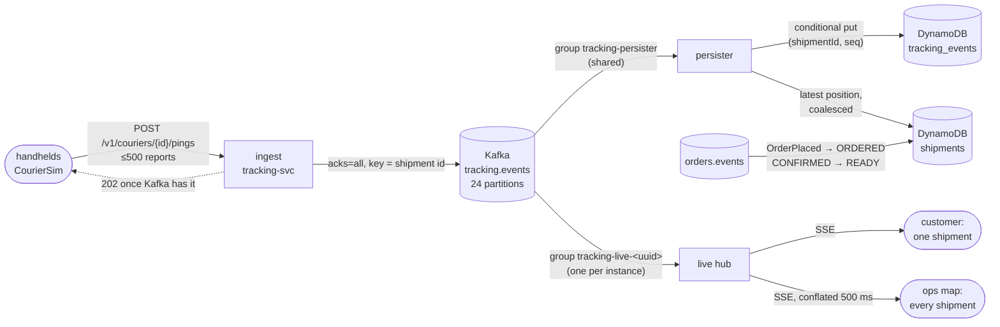

# 05 — The courier firehose

Once an order is confirmed, every courier's handheld becomes a sensor. It reports a position
every second and scans the package at each step: picked, loaded, out for delivery, delivered.
On a peak day that is tens of thousands of reports per second, nearly all of them positions
that will be stale a second later. The customer wants to watch one dot move. Operations wants
to watch all of them.

M5 adds tracking-svc. The rule that shapes it: **ingest never waits for the database.** A report
is accepted once Kafka has it. Storage, the latest-position table and the live push all
read from the topic at their own pace. This chapter measures that rule at 2,000 to 20,000
reports per second, pauses the database in the middle of a run, and fixes the bottleneck the
measurement exposed.

> Benchmarks ran on GitHub-hosted runners (4 vCPUs, AMD EPYC 9V74), using
> `tools/bench/tracking-firehose.sh` from the bench workflow. Kafka, DynamoDB Local,
> tracking-svc and the simulated couriers all share those four CPUs. The numbers say what this
> design does on one small machine, not what DynamoDB itself can do.

## 1. The shape



There are two consumer groups on the same topic, because they need different things:

| Group | Members | Sees | Commits |
|---|---|---|---|
| `tracking-persister` | shared by all instances | each report once, somewhere | after the batch is in DynamoDB |
| `tracking-live-<uuid>` | one group per instance, `latest` | every report, on every instance | nothing that matters: history comes from DynamoDB |

A browser's SSE connection can land on any instance. If live push used the shared group, an
instance would only see the shipments whose partitions it happens to own.

Shipments come from the order events. `OrderPlaced` creates the item with its owner and
region, and the saga's `OrderStatusChanged` makes it `READY` with the promised date, or
`CANCELLED`. The first start of tracking-svc on the laptop read the 80 orders that M2–M4 had
left on `orders.events`:

```
created DynamoDB table tracking_events
created DynamoDB table shipments
78 × shipment … -> READY
shipment 033R27RDYG000 -> CANCELLED      ← the declined card from chapter 04
shipment 033R2F0KJG000 -> CANCELLED      ← the out-of-stock order
```

## 2. Every write only moves forward

At-least-once delivery means every report can arrive twice, and two reports for one shipment
can arrive in either order. So each write carries its own condition, and DynamoDB enforces it:

| Write | Condition | What it stops |
|---|---|---|
| Report into `tracking_events` | `attribute_not_exists(seq)` | a redelivered batch or a handheld's retry stored twice |
| Latest position | `positionSeq < :seq` | an older position overwriting a newer one |
| Status from a scan | `statusSeq < :seq AND status <> CANCELLED` | a late PICKED undoing DELIVERED; a courier reviving a cancelled order |
| `READY` / `CANCELLED` from the saga | `status = ORDERED` | a replayed order event moving a shipment backwards |

Scans and positions are tracked separately, each with its own seq, so a newer position never
blocks an older scan from setting the status. The tests post the same batch twice and assert
the counters: 20 stored and 20 duplicates. They also scan a cancelled shipment and check that
it stays `CANCELLED`.

## 3. The stream: history, then live, with no gap

The customer's page opens `GET /v1/shipments/{id}/events` (SSE). It needs everything so far and
then everything new, without missing the reports that arrive while the history is being read,
and without showing any report twice.

```
1. subscribe to the live hub for this shipment, buffering (up to 256)
2. query DynamoDB: seq > Last-Event-ID, ascending
3. send history, then drain the buffer, then stay live
   — anything with seq ≤ the last one sent is dropped
```

`TrackingApiTest` pins it. After five stored positions, the stream sends ids `1 2 3 4 5` from
history. Then the courier re-sends 4 and 5 along with 6 and 7, and the stream sends `6 7`. A
reconnect with `Last-Event-ID: 6` gets `7 8` and nothing else.

Each subscriber has a bounded queue. A browser tab that stops reading loses its oldest reports
(counted as `tracking.live.dropped`), and never slows the Kafka consumer or other subscribers.
The ops map goes one step further. Every 500 ms it sends one frame holding the newest position
of each shipment that moved, so the browser's load depends on the number of shipments, not on
how often couriers report.

## 4. The firehose, first version

Each step runs N shipments on N/20 couriers. Every courier posts once a second with 20 reports,
for 30 s. "Drained" is how long after the couriers stopped the persister caught up with
everything ingest had accepted.

The first version wrote two things per report: the event, and the shipment's latest position
(one write per shipment per Kafka batch).

| Reports/s | Accepted | POST p50 / p99 | Live delay p50 / p99 | Drained after | Shipment writes |
|---:|---:|---:|---:|---:|---:|
| 2,000 | 66,000 / 66,000 | 16.9 / 212.7 ms | ≤22 / ≤246 ms | 15 s | 21,653 |
| 5,000 | 165,000 / 165,000 | 10.3 / 259.7 ms | ≤11 / ≤358 ms | 61 s | 85,133 |
| 10,000 | 330,000 / 330,000 | 12.5 / 954.3 ms | ≤14 / ≤805 ms | 176 s | 284,058 |
| 20,000 | 660,000 / 660,000 | 58.1 / 2,319.9 ms | ≤50 / ≤2,505 ms | 406 s | 658,182 |

(Delay percentiles come from histogram buckets, so they read as "at most".)

Ingest accepted every report at every step. Live push stayed within tens of milliseconds at the
median: a report reached the hub, ready to push, about one Kafka hop after the handheld sent it.
The persister was the part that fell behind. At 20,000 reports/s it finished storing them
406 s after the couriers stopped. That is 1.32 million DynamoDB writes in 436 s, about
3,000 writes/s, which is where DynamoDB Local tops out on this runner.

The column on the right shows the cost. Each courier reports every shipment once a second, and
a Kafka batch of ~495 reports rarely holds two reports for the same shipment. So "one position
write per shipment per batch" came out as one position write per report. Half of all writes
went to a value that is overwritten a second later.

## 5. Write coalescing

The shipment item answers "where is it roughly, what is its status". The exact track is in
`tracking_events`, and the live dot comes from the stream. So the item's position only needs to
be current to within a few seconds. `PositionCoalescer` writes a shipment's position at once if
it has not been written in the last 5 s. Otherwise it parks the newest position in memory,
replacing any older parked one, and a flusher writes it when the 5 s are up.

The same runner type, the same steps, `position-write-interval=5s`:

| Reports/s | POST p99 | Live delay p99 | Drained after | Shipment writes | |
|---:|---:|---:|---:|---:|---|
| 2,000 | 117.1 ms | ≤112 ms | 0 s | 11,745 | was 21,653 |
| 5,000 | 40.6 ms | ≤67 ms | 19 s | 32,019 | was 85,133 |
| 10,000 | 106.6 ms | ≤112 ms | 61 s | 58,932 | was 284,058 |
| 20,000 | 559.6 ms | ≤626 ms | 153 s | 150,120 | was 658,182 |

At 20,000 reports/s, shipment writes fell from 658,182 to 150,120 (4.4× fewer). The backlog
drained in 153 s instead of 406 s: 660,000 reports stored in 183 s, about 3,600 reports/s
against 1,500 before, or 2.4× the throughput on the same database. Ingest and live push got
faster too. They share four CPUs with DynamoDB Local, and a database doing less work leaves
them more.

What coalescing costs: a parked position is lost if the instance dies before the flush. The
event table still has it, and the next report replaces it within a second anyway.

What is still slow: at 20,000 reports/s the persister ends 153 s behind, so a reloaded page can
miss the last two minutes of track until it catches up. The live dot does not lag, and a real
DynamoDB table in on-demand mode scales its partitions with the load, which DynamoDB Local
cannot. The next lever, not built yet: batch the event puts (`BatchWriteItem`, 25 items per
request), which gives up the duplicate counter but keeps idempotency, since a repeated put
writes identical bytes.

## 6. Pausing the database mid-run

5,000 reports/s for 60 s, with DynamoDB Local frozen (`docker pause`) from t = 15 s to t = 35 s:

```
t=  5s  sent 5040/s  accepted 5040/s  errors 0  POST p50 10.4 p99 33.3 ms
t= 15s  sent 5020/s  accepted 5020/s  errors 0  POST p50  6.7 p99 27.1 ms   ← paused
t= 20s  sent 5000/s  accepted 5000/s  errors 0  POST p50  5.5 p99  8.2 ms
t= 30s  sent 5000/s  accepted 5000/s  errors 0  POST p50  5.5 p99  7.5 ms
t= 35s  sent 5000/s  accepted 5000/s  errors 0  POST p50  7.2 p99 45.1 ms   ← unpaused
t= 50s  sent 5020/s  accepted 5020/s  errors 0  POST p50  7.7 p99 23.4 ms
total: 315000 reports in 15000 posts, 315000 accepted, 0 failed posts
```

(First run, before coalescing; the second run matched it with 0 failed posts.)

Couriers did not notice. Ingest latency even dropped while the database was frozen, because the
persister stopped competing for CPU. Afterwards:

| | before coalescing | with coalescing |
|---|---:|---:|
| reports stored | 314,359 | 314,436 |
| duplicates refused | 641 | 564 |
| stored + duplicates | 315,000 | 315,000 |
| drained after | 105 s | 41 s |
| persister errors logged | 18 | 12 |

During the pause, DynamoDB calls timed out and the batch failed. The error handler retries a
failed batch with backoff (200 ms, ×2, at most 10 s) for as long as it takes, and never skips
it. Some puts in the failed batch had already succeeded, so the retry re-sent them, and the
conditional put refused them as duplicates. Every one of the 315,000 reports ended up stored
exactly once.

## 7. What the real runs broke

- **Every report failed on the laptop: `0 accepted, 561 failed posts`, each after ~2 s.** The
  compose Kafka refuses implicit topic creation, and nothing had declared `tracking.events`. Each
  send waited `max.block.ms` (2 s) for metadata of a topic that would never exist. The tests had
  passed because the Testcontainers broker auto-creates topics. Two fixes: tracking-svc now
  declares the topic (24 partitions), and a Kafka failure on ingest answers
  `503 Retry-After: 1` instead of a bare 500, so the handheld keeps the batch and retries.
- **CI hung for 30 minutes** in `TrackingApiTest`. The live consumer joins a new group at
  the `latest` offset, so it sees only what is produced after it owns partitions. On the slower
  runner the test posted before that, the stream never got the reports, and
  `StepVerifier.verifyComplete()` waited forever. The tests now wait for the 24 partitions to be
  assigned, and every `verify` has a timeout. In production the same gap is harmless: a page
  that connects during it gets those reports from DynamoDB history.
- **The first benchmark's persist-delay percentiles all read `Infinity`.** Micrometer's timer
  histogram tops out at 30 s by default, and the persister was minutes behind. The persist delay
  histogram now goes to 15 minutes and the live delay histogram to 5.
- **A laptop out of memory.** Halfway through, the laptop (shared with other projects' builds)
  ran out of memory, and Docker was shut down. The rest of M5 was measured on GitHub runners, and
  the Testcontainers suites ran in CI.

## Reproduce

```bash
./gradlew :services:tracking-svc:build          # Kafka + DynamoDB Local via Testcontainers
make infra-up PROFILES="auth aws"
java -jar services/tracking-svc/build/libs/tracking-svc.jar &
java tools/simulator/CourierSim.java http://localhost:8085 2000 100 1 60       # 2,000 reports/s for 60 s
curl -s localhost:8085/actuator/prometheus | grep -E '^tracking_(ingest|persist|live)'

# Watch one shipment (owner or role ops):
TOKEN=$(curl -s localhost:8180/realms/conveyor/protocol/openid-connect/token \
  -d grant_type=password -d client_id=conveyor-cli -d username=alice -d password=alice | jq -r .access_token)
curl -N localhost:8085/v1/shipments/<orderId>/events -H "Authorization: Bearer $TOKEN"

# The benchmark on a clean runner (bench workflow, inputs tracking_firehose=true,
# tracking_position_interval=0s|5s), or locally:
RATES="2000 5000" tools/bench/tracking-firehose.sh
```
