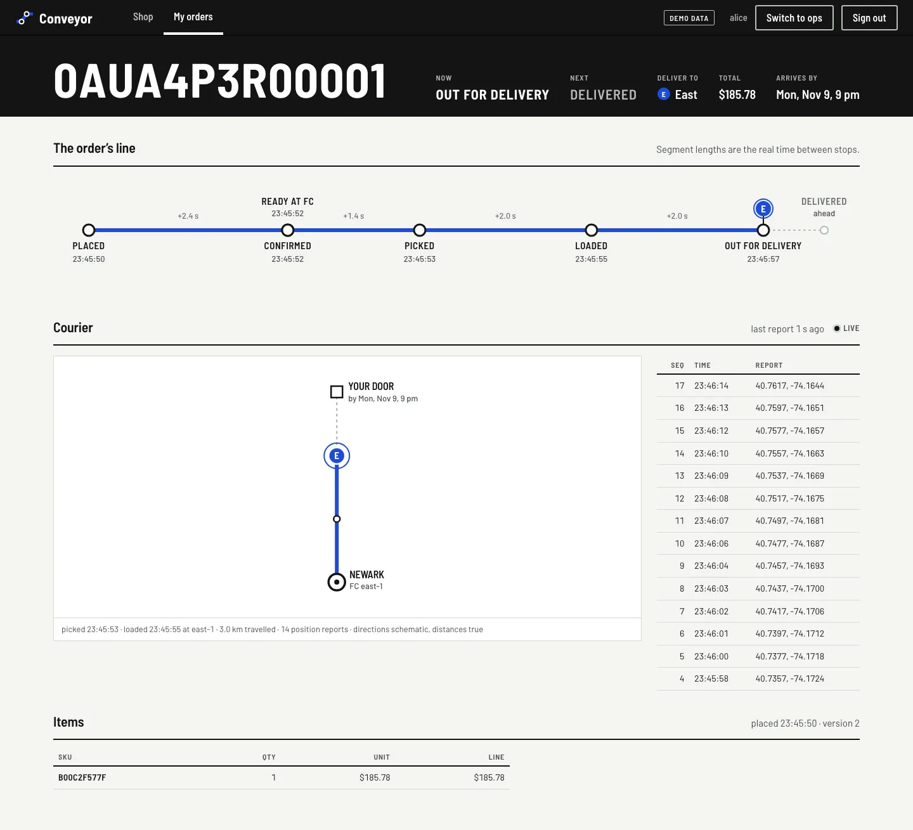
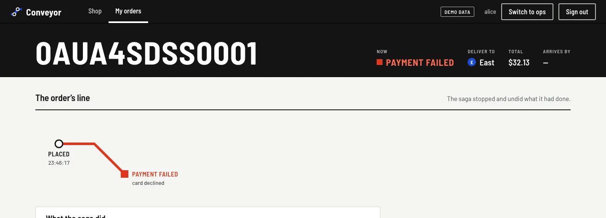
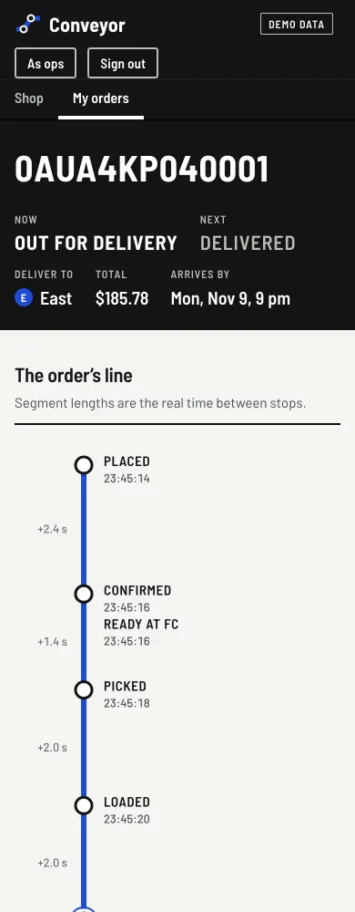
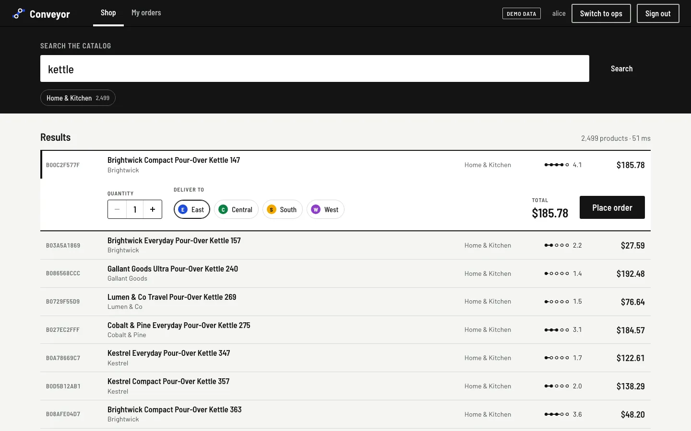
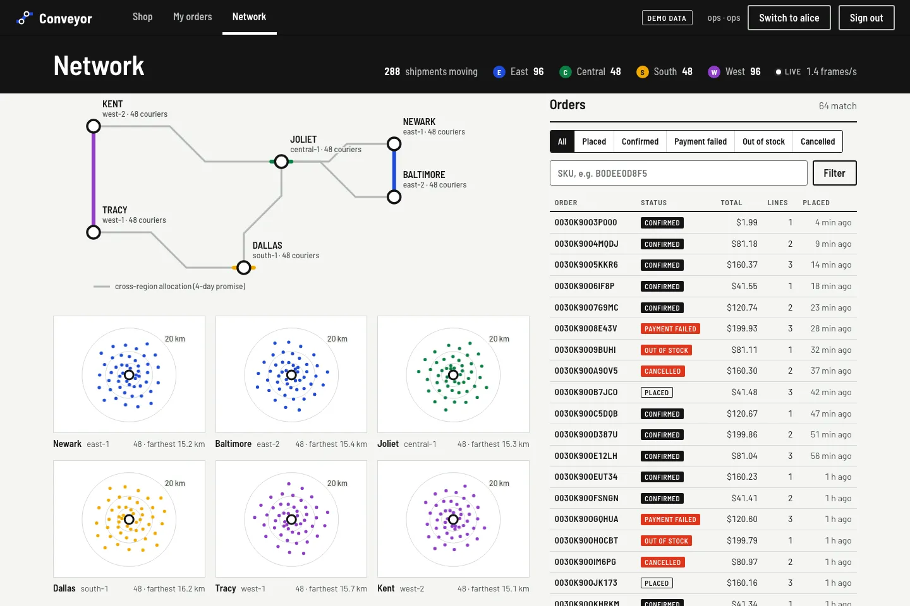

# 06 — The web, drawn as a transit map

Chapters 02 to 05 built an order's whole journey: a transaction and an outbox event, a Temporal
saga, a reservation in an FC, a courier's stream of reports. All of it was visible only in logs
and metrics. M6 adds `web/`, a React + TypeScript app on Vite, where the journey can be seen. It
has three surfaces: the shop, an order followed live, and the network view for operators.

This chapter covers the design decision, how the live views read the backend, and what a fresh
reviewer found wrong with the first build.

## 1. One idea: the platform is a transit network

The interface was designed with the impeccable skill. Its direction round deals one
direction at random from a ranked list of seven, so the result does not drift to the
category default: a dark dashboard, a card grid, or a marketplace clone. The direction dealt
was **transit-diagram wayfinding**, the Vignelli and Beck tradition of schematic line maps and
station signage. It fits the domain closely:

| In the platform | On the map |
|---|---|
| an order | a line |
| a saga step or a courier scan | a station |
| a fulfillment center | an interchange |
| a region (us-east, …) | a line colour and a route bullet (E, C, S, W) |
| a failed saga | a branch at 45° to a vermilion terminus |
| the courier | the line's bullet, riding it |

The rest follows from the signage world. The ground is white like a platform wall. Black
sign bands carry white Barlow Semi Condensed. There is one saturated colour per region.
Vermilion means failure and appears nowhere else. Numbers are set with tabular figures. The
interface has no cards, gradients or hero metrics.

The order page carries the idea in its first screen. The order id is the headline in the sign
band, next to a platform sign: **NOW** Out for delivery, **NEXT** Delivered. Below it the
order's line runs across the page:

```
PLACED ── CONFIRMED/READY ── PICKED ── LOADED ── OUT FOR DELIVERY ┄┄ DELIVERED
   +2.4 s              +1.4 s     +2.0 s     +2.0 s        (E)
```

Each segment is as long as the real time between its stations (with a floor, so that a 40 ms
step stays readable), and the time is printed above it. CONFIRMED and READY come from the same
event. The saga's `OrderStatusChanged` is what makes tracking-svc mark the shipment READY, so
the two are drawn as a single interchange, not given a gap that never happened. A declined
card leaves the line at Placed, bends 45° and ends at a vermilion square: **PAYMENT FAILED**,
"card declined".







## 2. Reading the backend live




| Surface | Calls (through the gateway) | Live by |
|---|---|---|
| Shop | `GET /api/v1/search`, `POST /api/v1/orders` with `Idempotency-Key` | — |
| Order | `GET /api/v1/orders/{id}`, `GET /api/v1/shipments/{id}`, `GET /api/v1/shipments/{id}/events` | polling until the saga decides, then SSE |
| Network | `GET /api/v1/ops/map` (role ops), `GET /api/v1/ops/orders` | SSE, conflated frames every 500 ms |

Details that came from the backend's rules:

- **One idempotency key per intent.** The buy panel creates a UUID when it opens and keeps it
  for that quantity and region. A double click, or a retry after a timeout, sends the same key,
  and order-svc returns the same order.
- **SSE over `fetch`, not `EventSource`.** `EventSource` cannot send an `Authorization` header,
  and the shipment stream needs one: a customer sees only their own shipment. The reader
  reconnects with backoff (1 s, doubling to 15 s) and sends `Last-Event-ID`, so tracking-svc
  sends only what was missed (chapter 05, section 3).
- **The gateway had to change.** Its global response timeout was 5 s, which would have cut
  every stream off after five seconds. The `shipments` route and a new `ops-map` route now set
  `response-timeout: -1`.
- **Sign-in** uses Keycloak's authorization code flow with PKCE, on the realm's public client
  `conveyor-web`. Tokens stay in `sessionStorage` and are renewed silently.

## 3. A demo mode that tells the truth about itself

On the laptop the full stack is Postgres ×2, Redis, Kafka, Debezium, OpenSearch, Temporal,
DynamoDB, Keycloak and eight JVMs, which does not fit in its memory alongside everything else.
`npm run demo` runs the same app against an in-browser simulation of the backend, and the top
bar says **DEMO DATA** while it does. The simulation follows the real rules:

- The catalog is the same 100,000 products as catalog-svc's seed: the same SQL hash functions,
  ported to TypeScript. Row 55,610 is `B0DEB89B1A`, "Juniper Lane Everyday Dark Chocolate 810",
  $94.06, rated 4.5, in the demo and in OpenSearch.
- Totals ending in .13 are declined and totals ending in .37 wait for a payment callback,
  as in payment-mock.
- A confirmed order gets a courier who scans PICKED, LOADED and OUT FOR DELIVERY, then reports
  a position every 1.2 s along an L-shaped route out of the region's FC.

`npm run dev` uses the real gateway.

## 4. What the review found

The impeccable flow ends with a reviewer that has no access to the build thread's reasoning. It
gets only the request, the direction contract and the screenshots. Two inspection rounds had
already happened in the build thread by then:

- The first national map, a US basemap with every courier as a dot, showed almost nothing.
  Couriers drive within 3–20 km of their FC, which is a few pixels at national scale, so all
  288 dots sat under six FC rings.
- On a phone, the horizontal line rotated its labels and still clipped them, so narrow screens
  now get a vertical strip map.

The reviewer's first verdict was **fix**, with eight material findings. The ones that mattered:

1. **The transit idea stopped at the order page.** The ops view was still a geographic basemap
   with bubbles. It is now a schematic network:
   - Each region's line runs through the FCs that serve it first; inventory-svc reserves in the
     customer's region before anywhere else.
   - A grey trunk stands for cross-region allocation (the four-day promise).
   - On a phone the network cascades down the screen.
   - Six metro insets, 25 km around each FC, show the couriers themselves.
2. **The courier map was a raw GPS trace on an empty grid.** It is now a route diagram:
   - The track is simplified into legs, and each leg is snapped to 45° or 90° with its length
     kept.
   - The FC is an interchange carrying the picked and loaded times.
   - The part not yet travelled runs dashed to a **YOUR DOOR** terminus with the promised date.
   - The caption says what is schematic: directions, not distances. The platform does not know
     the address, so the door is placed ahead, not located.
3. **A missing station.** READY was missing from the line. The status was a boxed tag where
   the world called for a platform sign.
4. **The banned template.** The ops header was a hero-metric strip of big numbers and small
   labels, a template the craft floor bans. It is now one legend row inside the sign band.
5. **Smaller findings:**
   - Pagination: the shop said "2,499 products" and showed 25. It now says "Showing 25 of
     2,499" and offers "Show 25 more".
   - Copy: the placed-order text contradicted itself.
   - A mobile overflow.

Its second verdict scored five fixes resolved and three partial, and found four regressions
from the fix batch:

- legends running across the trunk lines;
- both persona-switch labels showing at once on mobile;
- a clipped caption;
- READY drawn 64 px after CONFIRMED although the two are 0 ms apart.

The last of these is the one the design is about. A line that promises "segment lengths are the
real time between stops" cannot add a gap that never happened, so stations reached at the same
instant now stack as one interchange.



The third and last verdict scored three of the four items resolved, with no regressions. It
ended on **fix**, with one item open: on both widths, the grey trunk lines still pass through
some legend text (Joliet's on desktop; Tracy's and Dallas's on a phone). The run's budget was
two fix rounds, so it ships with that item open. It is recorded as known drift in `DESIGN.md`.

The review's screenshots were taken in demo mode. The live path through the gateway (Keycloak
sign-in, SSE through the gateway) typechecks, builds in CI, and uses the same endpoints the
service tests in chapters 02–05 exercise. It has not yet been driven end to end in a browser
against the full stack. That run is planned for M7, together with the resilience work.

## Reproduce

```bash
cd web && npm ci
npm run demo                 # http://localhost:5280, simulated backend, labelled DEMO DATA
npm run dev                  # http://localhost:5280 against the gateway on :18080
                             # (CONVEYOR_GATEWAY=... to change; 5173/5174 are taken on this machine)
npm run typecheck && npx vite build
```

Sign in as `alice` / `alice` (customer) or `ops` / `ops` (role ops). In demo mode the top bar
switches between them.
