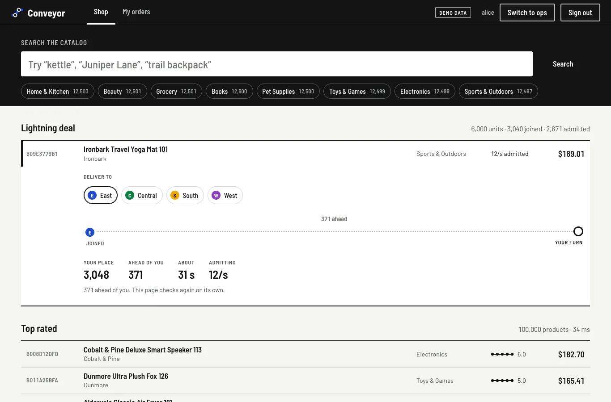
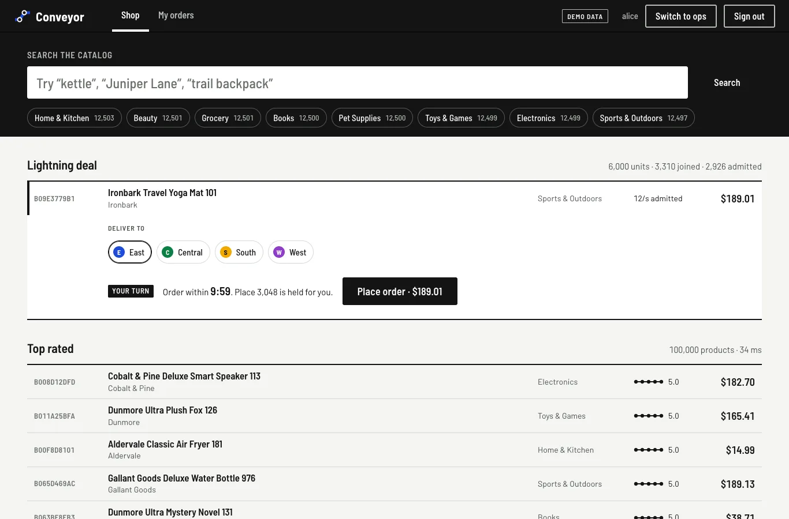

# 09 — The line

Chapter 08 ended with two things a real deal day needs that Conveyor did not have. The first
was a **virtual waiting room** in front of the deal: 80 % of the buyers got a 503 and the rest
won a race. The second was **per-route admission**, because the deal and regular checkout shared
one "critical" limit, and during the deal regular customers were turned away with the deal
crowd (35 of 240 got in). This chapter builds both. It then runs the same Prime Day again and
reports what changed and what did not.

## 1. The line is three numbers

A waiting room has to answer 7,000 people "where am I?" over and over, and the answers must
agree across every gateway instance. Conveyor keeps the whole line in three Redis values per
deal:

```
deal:lightning-1:issued    6511    INCR on every join: the last place handed out
deal:lightning-1:frontier  2309    every place up to here is admitted; only moves forward
deal:lightning-1:rate      27.2    admissions per second, set by the leader
deal:lightning-1:available 3104    the SKU's unreserved stock, read by the leader each second
deal:lightning-1:leader    <uuid>  3 s lease: the one instance that moves the frontier
deal:lightning-1:join:<customer>:<Idempotency-Key>   the place a join got (1 h)
```

Joining takes an `Idempotency-Key`, just as placing an order does. A join retried after a
timeout gets the same place back (`200`, `Idempotent-Replayed: true`) instead of a new one.
The join is one Lua script: `GET` the key, or `INCR` and `SET`. Section 4 shows what happened
without it.

A place in line is a **ticket**: `(deal, place)` signed with HMAC-SHA256. The gateway does not
store who holds which place. It reads the place back out of the ticket on every poll, so the
line costs one `INCR` per customer and nothing per poll.

```
customer                       gateway (any instance)                    Redis
   │ POST /api/v1/deals/lightning-1/queue
   │──────────────────────────────▶│ INCR issued ───────────────────────────▶│ 4212
   │◀── 201 {ticket, place 4212, ahead 1830, etaSeconds 92, pollAfterMs 46000}
   │        … 46 s …
   │ GET /api/v1/deals/lightning-1/queue/{ticket}
   │──────────────────────────────▶│ place 4212 ≤ frontier?  (cached, no Redis)
   │◀── 200 {state ADMITTED, admission, admissionExpiresAt +10 min}
   │ POST /api/v1/orders   Conveyor-Admission: <admission>
   │──────────────────────────────▶│ signature ok → deal lane → order-svc
```

Every second, each instance tries `SET leader NX PX 3000` or renews its own lease. The leader
does two things:

- It sets the **rate** from what the deal lane saw in the last second. If deal orders were shed
  or failed, or their mean latency was above 500 ms, the rate drops by a quarter. Otherwise, while
  people are waiting, it grows by 5 % (at least 1/s). This is additive increase and
  multiplicative decrease, the same family as the edge's adaptive limit.
- It **advances the frontier** by the rate with one Lua script:
  `min(capacity, issued, frontier + step)`, written only if it is larger. Two leaders during a
  lease handover cannot move the frontier twice or backwards.

Then every instance caches `issued`, `frontier` and `rate` and answers polls from memory.

**Capacity comes from stock.** Once a second the leader also reads the deal SKU's unreserved
stock from inventory-svc. It keeps the *outstanding* admissions at stock × 1.1. Outstanding
means admitted within the admission lifetime (ten minutes) and not yet turned into a
reservation. Some admitted customers never order, so the line admits a little more than the
stock. Admissions held by customers who walked away expire after ten minutes, and their stock
goes to the next places in line. When stock reaches zero, everyone still waiting is told "sold
out" at their next poll, and so is every later join. The saga's inventory reservation still
enforces the stock; the line only decides who gets to try. Section 4 shows the first design,
a fixed cap of units × 1.1 places, leaving 1,852 units unsold.

**Polling cost.** Every answer carries `pollAfterMs`, about half the time to the customer's
turn: 1 s when close, at most once a minute when far back. The first run capped it at 15 s, and
section 3 shows why that was not enough.

## 2. Admissions, and a lane of their own

Once a customer is admitted, the poll answer carries an **admission**: `(deal, customer, expires
at)`, signed with the same key, valid for ten minutes. It is checked in two places:

| Where | What it checks | Why there |
|---|---|---|
| gateway `AdmissionFilter` (before the shedding filter) | signature, expiry | a forged admission must not take a slot in the deal lane |
| order-svc `DealAdmissions` | the admission's deal is the SKU's deal, its subject is the token's subject, one unit | only order-svc knows the SKU and the customer together |

order-svc refuses the deal SKU without an admission (403, with a link to the line). That is what
makes the line mandatory and not just polite: a script that skips the line and posts orders
straight away gets nothing. The secret is shared by the gateway and order-svc (in Kubernetes,
a Secret both pods mount; see `deals.secretName` in the chart).

**The deal lane.** In `LoadSheddingFilter`, an order that carries an admission goes into its own
lane. It counts against the overall concurrency limit like any order, and also against a lane
cap of half the limit. A deal can therefore use at most half of checkout; the other half stays
open for regular customers whatever the deal does. The edge SLI gained a `lane` tag
(`deal` / `default`), so the dashboards and the run report can tell the two apart. The
checkout SLO still counts both, because a deal buyer turned away is still a customer turned
away.

The tests cover each piece on its own:

- `LineTest`: the line's arithmetic.
- `DealTokensTest`: forged, expired and swapped tokens.
- `DealAdmissionsTest`: wrong customer, wrong deal, two units.
- `LoadSheddingFilterTest.aDealCannotTakeTheSlotsRegularCheckoutNeeds`: the lane cap.
- `WaitingRoomApiTest`, against a real Redis. Six customers join a 4-unit deal that admits 2 a
  second. The last two hear "sold out" at once, the fourth is admitted within seconds and gets an
  admission only when signed in, and a forged admission never reaches order-svc.

## 3. The page



On the storefront the deal is a catalog row like any other, above the results, and it opens in
place (no modal). The line is drawn in the transit vocabulary of chapter 06:

- the station on the left is where the customer joined;
- the ringed station on the right is their turn;
- the front of the queue is the train coming toward them, in their delivery region's colour.

The figures are the gateway's own answer: place, ahead, about how long, and the current
admission rate. The page polls when the gateway says to. If a poll fails it says so ("Lost touch
with the line. Your place is kept"), and tries again in 3 s.



Admitted, the row shows the ten-minute countdown and a single Place order button: one unit,
with the admission attached. An expired admission (403) sends the customer back to the line with
a sentence saying why. A 503 tells them their place is kept and to press the button again.

## 4. Five runs on one machine

The Prime Day from chapter 08 ran again, unchanged except that the 7,000 deal buyers now go
through the line:

1. join;
2. poll when told to;
3. order with the admission;
4. give up after five minutes in line.

Each run is one 4-vCPU GitHub runner with the whole platform on it. Two of the five runs found
bugs in the line, and both are fixed. All five are reported.

| | Run 1 | Run 2 | Run 3 | Run 4 | Run 5 |
|---|---:|---:|---:|---:|---:|
| Couriers (shipments) | 2,000 | 2,000 | 2,000 | 200 | 200 |
| What was new | first line | harness retries | idempotent join | same as 3 | stock-based capacity |
| Places handed out (7,000 buyers) | 6,511 | **19,724** | 6,816 | 7,000 | 7,000 |
| Deal orders confirmed | 1,562 | 613 | 1,055 | **4,148** | 1,214 |
| Deal stock afterwards = 6,000 − confirmed | 4,438 | 5,387 | 4,945 | 1,852 | 4,786 |
| Regular orders during the deal (of 240) | 201 | 46 | 35 | 139 | 60 |
| Regular orders at peak (of 1,800) | 937 | 243 | 202 | 1,669 | 797 |
| Checkout availability (SLO 99.9 %) | 80.2 % | 64.1 % | 74.7 % | **91.5 %** | 57.7 % |
| Checkout under 300 ms (SLO 99 %) | 58.2 % | 43.8 % | 52.5 % | 88.5 % | 47.3 % |
| Line polls that timed out | not counted | 15,841 of 23,005 | 25,852 of 37,305 | 218 of 46,158 | 14,940 of 41,695 |
| Warm-phase search p50 (before any deal) | 322 ms | 296 ms | 329 ms | **136 ms** | 222 ms |

For comparison, chapter 08 without a line:

- 2,000 couriers: 811 deal orders, 31.5 % checkout availability.
- 200 couriers: 1,481 deal orders, 39.9 % availability, 35 of 240 regular orders during the deal.

### What held in every run

- **No unit sold twice.** The stock left was exactly 6,000 minus the confirmed count every time.
- **Every accepted deal order was confirmed.** The line changes who gets to try; the saga and the
  inventory reservation still decide.
- **Since run 3, one buyer holds one place.** In run 5, 7,000 buyers held 7,000 places,
  whatever their clients retried.

### What the runs found

**Run 1: a harness bug, and a polling cost.** The harness counted one timed-out poll as a lost
customer, so 5,427 buyers vanished from its tally. The web page retries; the harness did not.
The polls also had a cost: with the interval capped at 15 s, 6,000 people in line sent about
400 polls a second through the same saturated gateway as checkout. The cap is now 60 s.

**Run 2: joins were not idempotent, and the harness's own retries showed it.** A join that timed
out at the client had usually succeeded at the gateway, and a retry took another place. 7,000
buyers took 19,724 places. Their places were past the capacity, so 4,174 buyers were told "sold
out" while most of the stock was unsold. Retries every 3–5 s with no backoff made the machine
slower still: 15,841 polls timed out. Joining now takes an `Idempotency-Key`. Clients back off
exponentially with full jitter (a random wait up to 2, 4, 8 … 30 s).

**Run 4: the line worked, and a fixed capacity wasted stock.** This was the fastest machine of
the five (see the warm-phase row). Compared with chapter 08's run at the same courier load:

- deal orders went from 1,481 to 4,148;
- regular orders during the deal went from 35 of 240 to 139;
- checkout availability went from 39.9 % to 91.5 %;
- the 399 buyers past the capacity heard "sold out" in 0.2 s at the median.

But the line stopped at its fixed 6,601 places while 2,405 admitted customers had already given
up, and 1,852 units went unsold. Capacity now follows stock (section 1): admissions that expire
unused give their stock to the next places.

**Run 5: same load as run 4, a slower machine, and the line's weak point.** The new capacity rule
was never the limit (stock stayed above zero). Before the deal began, this runner's warm-phase latency was
1.6x run 4's. From the deal onwards, deal orders averaged
more than the 500 ms target, so the admission rate sat at its floor of 2 per second for most of
the run. 5,616 buyers gave up after five minutes. The line did what it was told: it protected
checkout from the deal. On a slow machine, though, the latency target cannot tell "the deal is
overloading checkout" from "everything on this box is slow", and the deal starves.

### Reading it

**The line fixes fairness and failure modes, not capacity.** No one wins a race of 503s, a
buyer far back is told so, and a retried join keeps its place. Regular checkout keeps its own
half of the limit: in no run did the deal lane push regular orders out the way chapter 08's
single limit did. The amount sold still depends on what the machine can confirm, which
varies by more than 2x between runners.

**One machine is now the whole limit.** In all five runs the edge's adaptive concurrency limit
sat at its floor of 8 from start to finish: on four shared vCPUs, every request was slow. Behind
a limit of 8, at about a second per order, checkout confirms about 8 orders a second whatever
the line does. Runs 4 and 5 differ by 3.4x in deal orders, on the same code and the same
load, and by 1.6x in latency before the deal started.

**What the next version should change:**

- **Serve the line from its own tier.** Joining and polling are cheap. On the same gateway as
  checkout, though, 40,000 polls are 40,000 JWT checks and HTTP exchanges on the busiest
  process. Real waiting rooms answer from the CDN or a separate fleet.
- **Set the admission rate from what the platform confirms**, not from edge latency. The
  saga's completions per second say "how many buyers can we finish", which is the question.
  Latency then becomes a guard, not the controller.
- **Keep a buyer's place alive with their polls.** Today an abandoned admission frees its stock
  only when it expires, ten minutes later. Places that stop polling could be skipped sooner.

## Reproduce

```bash
./gradlew :services:gateway:test --tests '*deals*' --tests '*LoadSheddingFilterTest'   # needs Docker for Redis
./gradlew :services:order-svc:test --tests '*DealAdmissionsTest'
tools/loadtest/prime-day.sh                       # or: prime-day workflow, courier_shipments 200 / 2000
cd web && npm run demo                            # the line on the storefront, simulated
```

